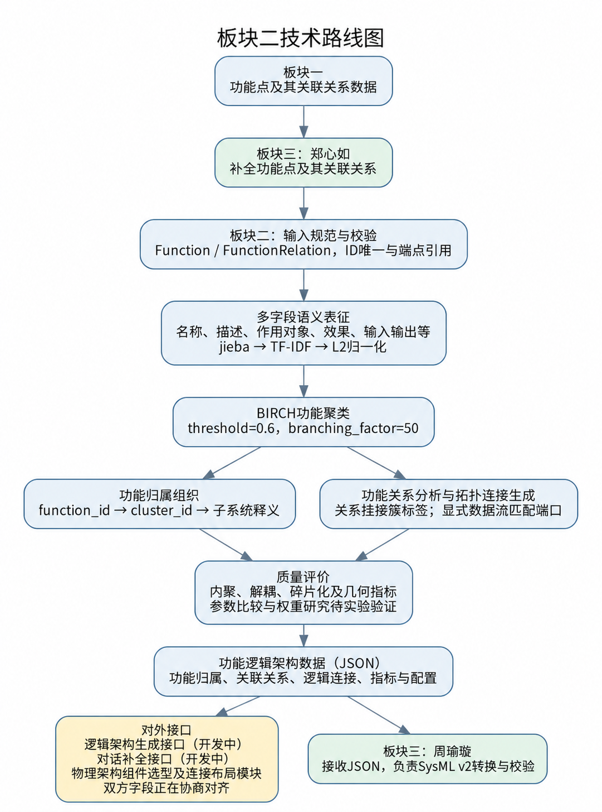
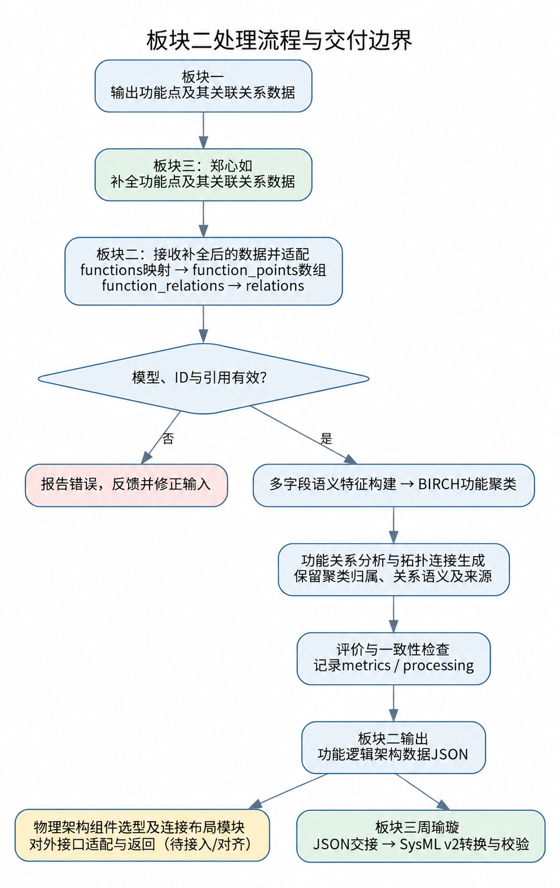
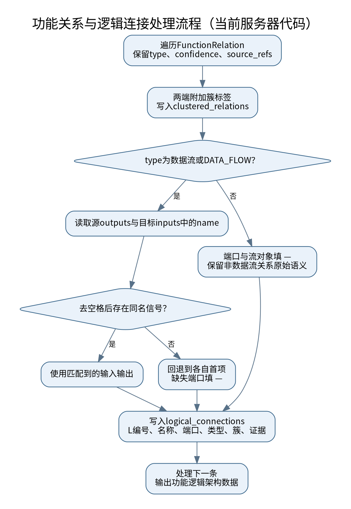

# 板块二：功能逻辑架构生成
## 研究进展、细化设计方案与关键接口

版本：V6.0｜更新日期：2026年10月28日

本版依据最新数据流向与图示简化说明、既有职责说明、《功能逻辑分析模块接口需求.md》、MBSE_app与指定服务器仓库整理，替代前版。统一以“功能逻辑架构数据”称呼板块二产出。本文核对了源代码、模型及现有测试文件，未连接实际服务器联调，也未重新运行依赖模型的完整流程；研究方案与当前实现分别说明。

## 一、模块定位与职责边界

板块一将功能点及其关联关系数据发送给板块三郑心如同学，由郑心如完成补全后交给板块二。板块二接收补全后的功能点及其关联关系，通过BIRCH功能聚类、关系归属分析和拓扑连接生成，生成功能逻辑架构数据，为物理架构组件选型及连接布局提供输入。

对外服务对象为“物理架构组件选型及连接布局模块”。根据最新接口需求，板块二承担逻辑架构生成、输入补全两个对外接口。功能逻辑分析模型内部在服务器上进行本地联调，内部服务调用与对外HTTP契约分别管理。

功能逻辑架构数据JSON具有两个输出去向：一路经开发中的对外接口适配，对接物理架构组件选型及连接布局模块；另一路交付板块三周瑜璇同学。前一路的接口与双方字段尚待接入和对齐，不能视为已经完成端到端联调。SysML v2转换、建模工具导入及校验由板块三负责，不再列入板块二的实施任务或完成指标。板块二负责JSON的结构、引用和来源一致性；双方交付方式、版本标识及回执另行约定。

## 二、研究进展与技术路线

### 2.1 板块二技术路线

板块二把补全后的功能点与关系组织成可用于后续架构设计的功能逻辑架构数据。技术路线为“标准功能点及其关联关系—语义表征—BIRCH功能聚类—功能关系分析与拓扑连接生成—质量评价—JSON交付”，功能ID和来源贯穿各环节，支持结果追溯。

输入阶段接收板块三郑心如同学基于板块一数据补全后的功能点及其关联关系。计算阶段用多字段语义与BIRCH形成初始聚类结果，再将功能关系挂接到聚类结果，表达逻辑连接。评价阶段检查内聚、解耦和碎片化，辅助参数调整与工程复核。交付阶段输出JSON并分为两路：一路经对外接口适配，供物理架构组件选型及连接布局模块使用（待接入/对齐）；另一路发送给板块三周瑜璇，由她完成SysML v2转换与校验。



| 环节 | 主要方法 | 阶段结果及作用 |
| --- | --- | --- |
| 输入规范与校验 | 标准功能模型，字段、ID和端点引用检查 | 可计算、可追溯的有效功能点及其关联关系 |
| 多字段语义表征 | 语义提取、分词、TF-IDF及L2归一化 | 表达功能相似性的特征矩阵 |
| BIRCH功能聚类 | 阈值控制聚类，功能ID关联簇标签 | 初始功能聚类及辅助业务释义 |
| 功能关系分析与拓扑连接生成 | 关系挂接所属簇，数据流匹配信号 | 功能点及功能簇之间的关联表达 |
| 质量评价与复核 | 指标、覆盖、碎片化与连接可信程度检查 | 参数调整、人工确认和修订依据 |
| JSON组织与交付 | 汇总归属、关系、连接、指标和配置 | 一路对接物理架构模块（待接入/对齐），另一路交给周瑜璇转换校验 |

当前关系图用于校验、标注和连接分析，尚未作为BIRCH图约束。两个对外接口均未完全完成：板块二与物理架构组件选型及连接布局模块的功能逻辑架构数据字段正在商讨，字段及映射规则尚未定稿。

术语说明：“BIRCH功能聚类”描述算法过程；“功能簇”“聚类归属”描述输出结果，二者不混用。“功能关系分析与拓扑连接生成”既保留依赖、并行等关系分析，也包含连接生成，避免仅写“拓扑连接”使非数据流语义被忽略；工程节点间使用“连接”，不使用网页语境中的“链接”。

### 2.2 阶段成果及当前成熟度

| 研究环节 | 已形成成果 | 现阶段重点 |
| --- | --- | --- |
| 输入契约与校验 | 标准功能点/关系模型，功能ID唯一性和端点引用校验 | 对齐PhysicalArchGenContext与内部数组模型 |
| BIRCH功能聚类 | jieba、TF-IDF、L2归一化和BIRCH已封装为服务 | 用案例评价多字段表征和阈值对聚类结果的影响 |
| 架构数据组织 | 功能归属、附簇标签关系、逻辑连接及指标形成统一结果对象 | 明确功能簇JSON及跨模块交付Schema |
| 信号连接处理 | 数据流优先匹配同名信号，非数据流保留关系语义 | 细化类型、单位、多端口及回退匹配标记 |
| 质量评价 | 几何、语义、孤立簇指标已有实现 | 统一评分目标，补充阈值比较和业务复核 |
| 接口集成 | 补全候选预览/人工确认已实现；编排可本地调用聚类 | 优先完善对话补全建议；两个接口开发中，双方正在协商字段 |
| 下游交付 | 以JSON交付功能逻辑架构数据 | 对接物理架构模块；与板块三确定JSON交接规范 |

第六次组会形成评价体系，第七次组会明确输入与权重研究方案，第九次组会明确功能聚类、关系及逻辑连接的数据组织方式。阶段资料中的SysML实施任务现已转交板块三，早期接口设想不作为本版契约。

### 2.3 代码依据与现状判断

MBSE_app体现了离线原型演进。本次接口分析以服务器仓库的function_clustering、unified_orchestration与interfaces实现为主，不再用原型中的独立查询服务描述当前对外接口。

核对仓库为sywule/requirements_processing_and_functions_extraction_pre_research，提交为f2d98e531021d618ed9fed4bed52124450aff988。聚类已封装为异步Python服务，由统一编排在补全后调用；聚类本身不需要模型API Key，补全另有模型依赖。

原始MBSE_app附带样例中7个功能点形成6个簇，孤立簇占比约0.8333，提示原型存在碎片化问题。该样例不是当前服务器版本实验结果，也不能与其他案例目录混合统计。当前仓库测试包含基本聚类输出、空关系和非法端点等检查，本次仅阅读测试文件，未将其记为执行通过。

## 三、细化设计方案

### 3.1 总体处理流程



上游数据流为：**板块一 → 板块三郑心如同学（补全） → 板块二（功能逻辑架构生成）**。板块二输出功能逻辑架构JSON后分为两路：**物理架构组件选型及连接布局模块（对外接口适配与返回，待接入/对齐）**和**板块三周瑜璇同学（JSON交接，SysML v2转换与校验）**。

板块一提供功能点及其关联关系；郑心如完成补全后将数据交给板块二。板块二执行输入校验、多字段语义表征、BIRCH功能聚类、功能关系分析与拓扑连接生成，输出功能逻辑架构JSON，分别用于对接物理架构组件选型及连接布局模块，以及发送给周瑜璇进行转换与校验。前一路的接口和字段仍在协商对齐。

技术路线图和总体流程图均采用简洁主流程，不展开对话补全节点、option判断及往返回路；上游标明郑心如负责补全，底部展示JSON输出的两条分支。技术路线图的黄色框列出开发中的两个对外接口，总体流程图用“对外接口适配与返回（待接入/对齐）”概括该分支。4.3节保留此前提出的对话式补全接口功能设计，与本次实际数据交接职责分开说明，两个对外接口及字段协商状态保持不变。

### 3.2 输入模型与功能点及其关联关系校验

输入校验分模型结构和关联引用两层。下表是当前服务器内部契约，不代表已与下游对齐的最终字段。

| 输入对象 | 当前结构与关键字段 | 约束及用途 |
| --- | --- | --- |
| 功能点及其关联关系（ClusteringInput） | function_points、relations数组 | 功能点至少1个；关系可为空 |
| 功能点FunctionPoint | function_id、name、description、domain | ID、名称、描述及领域必须显式提供且非空 |
| 功能语义 | target、effect、trigger、constraints、scenario等 | 按模型要求使用字符串、列表等类型；缺失可选信息不臆造 |
| 输入输出 | inputs、outputs为字典数组，如{"name":"电池温度"} | 为数据流匹配提供信号信息 |
| 功能关系 | left_function_id、right_function_id、type、confidence、source_refs | 端点ID非空；type为开放字符串或null；置信度可空，否则0至1 |
| 来源 | 功能及关系的source_refs | 保留提取或补全依据；关系模型要求提供，允许空数组 |

| 校验项目 | 当前处理 | 建议细化 |
| --- | --- | --- |
| 必填与类型 | Pydantic模型验证结构 | 给调用方明确字段位置及修正提示 |
| ID唯一性 | 重复功能ID报错 | 保留既有ID，记录补全新增ID与来源 |
| 关系引用 | 端点不存在抛ClusteringInputError | 用户增改功能/关系后重新验证 |
| 语义有效性 | 全部语义分词为空时报错，向量化可能另报空词表 | 增加单功能零向量和有效词项检查 |
| 关系重复与类型 | 当前不主动去重，不统一改写type | 与业务方确认去重及同义类型策略 |
| 下游契约 | 功能逻辑架构字段尚未对齐 | 明确双方字段语义、类型、必填、枚举和映射 |

校验通过只表示满足计算条件，不代表需求已完整或架构正确。对话补全应将结构错误、信息缺失与待确认假设分别说明。

### 3.3 多字段语义表征与BIRCH功能聚类

服务器使用多字段语义而非仅功能名称构造向量，递归提取字段值而不加入JSON字段名。

| 处理步骤 | 当前方法 | 作用与注意事项 |
| --- | --- | --- |
| 提取语义 | 名称、描述、对象、效果、触发、约束、领域、输入输出、能力、场景、工况、前后置条件等 | 表达意图与运行语境；公共领域描述可能掩盖功能差异 |
| 排除非语义信息 | 排除function_id、source_refs、extras和字段名 | 减少标识与来源对相似度的干扰，不删除原始来源数据 |
| 中文预处理 | jieba分词及固定停用词 | 降低无效词影响；后续验证领域术语、缩写与单位 |
| 向量化 | TF-IDF、L2归一化 | 形成统一尺度特征；检查空词表及零向量 |
| 聚类 | BIRCH；当前特征转为稠密矩阵 | 得到初始聚类结果；大样本需评估内存开销 |
| 聚类结果解释 | ID关联簇，关键词生成子系统名及释义 | 支持工程复核，不能直接代替物理组件选型 |

| 参数 | 当前值 | 含义及调整依据 |
| --- | --- | --- |
| birch_threshold | 0.6 | 子簇半径约束，非余弦相似度门槛；结合碎片化与案例比较 |
| branching_factor | 50 | CF树分支容量，可在Python服务构造时覆盖 |
| n_clusters | None | 不指定固定最终簇数，由当前聚类过程产生聚类结果 |

cluster_id只表示本次运行编号，不是稳定业务ID。实验应固定数据版本、字段组合、分词和评价口径，再比较参数影响，避免把数据变更与调参混在一起。

### 3.4 功能逻辑架构数据的组织

“功能逻辑架构数据”是整体交付名称。下述字段是当前内部结果的不同维度，不再以输出表数量定义板块二成果。

| 数据维度与当前字段 | 主要内容及用途 | 交付时的注意事项 |
| --- | --- | --- |
| 功能归属 architecture_layers | 功能ID/名称、层级、子系统、簇名称和簇ID | 当前层级固定component，未形成显式系统—子系统—组件三级树 |
| 功能关系 clustered_relations | 原关系及来源，增加left_cluster/right_cluster | 保留端点ID和type，不因聚类结果重新解释关系 |
| 逻辑连接 logical_connections | 连接编号、源/目标名称、端口、关系类型、流对象、簇和证据 | 当前缺少端点ID，跨模块交付建议补齐，避免同名功能混淆 |
| 评价 metrics | 样本/簇数量、几何与语义指标、孤立簇比例和评分 | 无法计算时为null，不是0分，也不是正确率 |
| 处理配置 processing | 功能/关系数量、阈值、分支因子和语义字段说明 | 用于解释本次结果，不能代替任务版本管理 |

对外需求规定逻辑架构是“包含function_id集合的功能簇”。可由architecture_layers按cluster_id聚合获得功能簇视图，但这一步尚需对外适配层。给板块三的JSON可同时保留关系、连接和来源信息。最终Schema、任务及版本字段须双方确认，不能把建议格式当成既定契约。

### 3.5 功能关系分析与拓扑连接生成



当前服务对每条输入关系附加两端簇标签，并生成相应逻辑连接记录，两者在该阶段一一对应。重复关系不会被本服务自动删除。

仅type为“数据流”或“DATA_FLOW”时读取源outputs和目标inputs中的name，优先匹配去空格后相等的信号名。没有同名匹配则回退到各自首项，缺失端填“—”，流对象取源端口。其他关系类型的端口和流对象均为“—”，保留原始语义，不伪装为数据连接。

此策略尚未完成数据类型、单位、接口协议和一对多信号匹配。首项回退不表示连接已获工程确认，建议后续输出匹配方式和待确认标记；非数据流关系也不能因无流对象而丢弃。

### 3.6 聚类评价与后续研究

当前服务器计算inner_similarity（簇内点对平均余弦相似度）、inter_similarity（簇质心间平均余弦相似度）、isolated_cluster_ratio（单元素簇数/总簇数），并在脚本条件满足时计算Silhouette和DB指数。遇单元素簇时当前脚本不会计算后两项，不能误写为指标理论本身禁止单元素簇。

architecture_score采用inner_similarity/inter_similarity，仅在指标有效且分母大于1e-6时计算；该比值不限定0至1。当前metrics没有Purity字段，不应声称已实现组会提出的0.35×InnerSim + 0.35×(1−InterSim) + 0.30×Purity。

后续固定数据和前处理，比较阈值变化下的聚类结果、碎片化与业务解释性；人工域标签具备后再研究Purity及权重敏感性。现阶段不预写“权重稳健”或“架构正确”等结论。共同领域文本可能影响功能差异，也应纳入特征分析。

### 3.7 处理伪代码与改进方案

#### 3.7.1 当前算法的伪代码

前版总体符合现有内核，但应明确配置、异常分支及内部输出边界。伪代码解释算法，不能替代运行代码或测试证据；对外适配和对话补全应与聚类计算分开表达。

```text
算法：当前功能逻辑架构数据生成内核
输入：功能点及其关联关系source；threshold=0.6，branching_factor=50
输出：ClusteringResult；输入无效或计算失败时抛出异常

1 验证ClusteringInput，取得points与relations
2 建立point_by_id；若ID重复或关系端点不存在，报错
3 提取功能语义（排除ID、来源、extras），分词、去停用词
4 若全部文本为空，报错
5 X ← L2Normalize(TFIDF(texts))；当前转为稠密矩阵
6 labels ← BIRCH(threshold, branching_factor, n_clusters=None).fit_predict(X)
7 建立function_id → cluster_id映射，生成辅助名称与architecture_layers
8 对每条关系r：
    保留类型、端点、置信度和来源，附加簇标签
    若r.type属于{数据流, DATA_FLOW}：
        以name同名优先、首项回退选择端口；流对象取源端口
    否则：端口与流对象为占位符
    追加clustered_relations与logical_connections
9 计算metrics；无法计算时为null；记录processing配置
10 返回内部结果，不假设与下游字段已对齐
```

#### 3.7.2 具体改进建议（待实施）

| 优先级与问题 | 具体方案 | 验证依据 |
| --- | --- | --- |
| P0 补全建议生成 | 列出缺失项、关联功能/关系、推荐内容、理由、依据和追问，为建议设置标识 | 用户能理解缺什么、为何补、如何回复 |
| P0 用户反馈吸收 | 支持全部/部分采纳、修改、拒绝及自行补充；仅合并明确内容，歧义先追问 | 拒绝项不写入，部分采纳只改对应项，自补内容不遗漏 |
| P0 字段对齐 | 独立适配层和字段映射清单，隔离内部模型与对外报文 | 双方共同JSON样例可消费，ID和引用不丢失 |
| P1 端口可解释性 | 输出匹配方式、候选与待确认状态；检查类型、单位兼容性 | 同名、单位冲突、多端口、首项回退分别验证 |
| P1 特征与参数评价 | 固定数据比较字段组合、阈值及簇大小分布 | 指标、聚类结果变化和人工解释性共同记录 |
| P1 稳定性与追溯 | 空词表/零向量检查，连接加端点ID，记录输入版本及采纳来源 | 异常可定位，同名不误关联，变更可回溯 |

```text
改进设计：对话补全与架构生成闭环（不是现有完整实现）
输入：已确认上下文C，本轮用户消息U，option中是否启用补全
识别U中的新增信息、采纳/修改/拒绝决定，并关联原建议
若存在歧义或冲突：保留有效内容，向用户定向追问
否则：校验并合并明确采纳及用户自行提供的内容，得到C'
若启用补全：
    检测C'中的信息缺口，生成有依据的候选建议和追问
    展示给用户，不自动写回未采纳建议
    用户继续完善时保留会话，进入下一轮
用户决定生成架构时：
    对当前已确认功能点及其关联关系计算架构数据
    按双方确认字段映射交付；未对齐时保留内部结果
```

#### 3.7.3 是否放代码或运行截图

正文保留核心伪代码与改进表，更便于说明“如何处理、为什么改”。完整代码留在仓库，附录可引用function_clustering/service.py中_cluster、_best_port等关键函数，选取短片段并标明文件和版本。

运行截图建议后续补充，用来证明“已经做到什么”：同一案例输入与聚类结果、补全建议及用户采纳/自补过程、确认前后JSON差异及更新后的架构。每张截图标注案例、版本、时间和结果，并保留对应JSON或日志。服务启动或HTTP 200截图不足以证明业务正确。

本次没有运行实际服务器，因此不加入模拟运行截图。先用设计图、伪代码与代码依据说明方案，功能验证后再补充真实运行证据。

## 四、关键接口与字段对齐进展

### 4.1 接口范围与共同上下文

两个对外接口目前均未完全完成。板块二生成的功能逻辑架构数据字段尚未与物理架构组件选型及连接布局模块对齐，双方正在商讨语义、结构和映射。本章先说明功能与进展，具体API细节后续调整；对外要求来自最新接口需求第2、第3项。第1项输入资源规范化不列为板块二新增接口；服务器内部编排、补全和聚类服务之间是本地调用关系。

共同数据包PhysicalArchGenContext包含task_id、system_description、functions、function_models、requirements、requirement_models、logical_architecture、attachments及function_relations。functions是function_id到Function的字典，requirements是req_id到Requirement的字典，键须等于对象内ID。当前模型采用严格校验并拒绝未知顶层字段，不直接接受旧id/event格式。

需求指出连续对话可能不重复之前信息，但当前代码未按task_id实现持久会话上下文合并。review_id仅用于补全候选确认，不能替代通用task_id增量会话。仅凭task_id恢复完整输入的行为仍需实现或另行约定。

### 4.2 对外接口一：逻辑架构生成（开发中）

| 项目 | 接口要求与代码分析 |
| --- | --- |
| 方法及路径 | POST /generate_logical_arch |
| 调用方 / 提供方 | 物理架构组件选型及连接布局模块 / 板块二 |
| 输入要求 | PhysicalArchGenContext对应JSON及生成选项 |
| 输出要求 | 逻辑架构JSON，核心为功能簇，每簇包含一系列function_id |
| 当前进展 | 对外接口未完全完成，字段正在协商；核对版本未发现该路由，内部聚类内核可复用 |
| 适配设计 | functions映射转function_points数组，function_relations转relations，聚类后按cluster_id聚合成员ID |
| 待确认 | 外层字段名、聚类结果Schema、options、错误码、空输入策略、是否写回logical_architecture、部署地址 |

建议外层采用physical_arch_gen_context与options以便与补全接口一致，但最新需求尚未锁定这一结构。Python构造器能覆盖阈值，并不代表HTTP已经支持阈值选项。

```text
/generate_logical_arch适配层（待实现）:
    校验上下文、功能点及其关联关系与生成选项
    result ← await FunctionClusteringService(...).cluster(ClusteringInput(...))
    groups ← 按cluster_id聚合architecture_layers中的function_id
    校验功能覆盖、引用一致性及JSON有效性
    返回双方确认的逻辑架构JSON
    # 是否写回上下文logical_architecture由正式契约确定
```

### 4.3 对外接口二：对话式输入补全（开发中）

本节保留对接物理架构模块的对话式补全接口功能设计，不代表当前主数据链路的补全归属。当前板块一数据由板块三郑心如同学补全后交给板块二；该职责已在总体流程中修正。接口设计与实际交接链路分别表述，避免将图中的补全工作误归到板块一或板块二。

补全是一个多轮对话过程。算法根据当前上下文给出缺失信息提示、推荐内容和定向问题，用户可采纳、部分采纳、修改建议，或自行提供所需信息。系统把明确采纳的推荐及用户自行补充内容校验后纳入上下文，再分析是否继续追问，形成“分析—建议/提问—反馈—合并—再分析”的闭环。

当前重点是先做好补全建议生成与用户反馈吸收。暂把“是否启用补全”作为option参数表达调用意图，正式名称、默认值和请求层级后续确定。启用补全不代表同意采纳全部候选，不能据此自动写入未确认内容；该选项与原资料中的only_check含义不同，不将only_check作为本阶段主流程。

| 对话阶段 | 板块二应完成的功能 | 用户参与及上下文处理 |
| --- | --- | --- |
| 缺口分析 | 检查功能、关系、条件、输入输出及依据 | 区分缺失、不确定与结构错误，不把猜测当事实 |
| 建议与追问 | 给出推荐内容、理由、依据及需用户提供的信息 | 明确针对哪个功能/关系，便于决定如何回应 |
| 理解反馈 | 识别采纳、部分采纳、修改、拒绝及用户自行补充 | 不把任意自然语言回复当作全部采纳 |
| 校验合并 | 检查类型、ID、引用与冲突，记录变更来源 | 明确内容进入上下文；歧义和冲突先向用户确认 |
| 继续对话或生成 | 基于更新上下文重新分析，必要时继续定向提问 | 用户选择继续完善或在明确剩余不足后请求生成 |

每条候选建议可包括建议标识、关联功能/关系、缺失项、推荐内容、理由/依据、追问和处理状态。这些是功能设计要素，不是定稿API字段。上下文更新后应检查旧建议是否仍适用，防止合并过期候选。

**对话示例（设计示意，非运行记录）：**

> 算法：已有温度采集和冷却执行功能，但冷却启动条件不明确。建议补充触发条件，请提供阈值及适用工况；没有依据时不自行填写具体数值。  
> 用户：采纳补充触发条件的建议，按本案例温度超过35℃启动冷却；另外增加传感器故障告警。  
> 算法：将用户提供的35℃条件纳入冷却功能，形成故障告警内容，并继续询问故障判定依据及告警接收方；确认后补齐关联关系。

示例中的35℃来自示意用户反馈，不是算法推断的工程标准。用户自行提出的新增内容也要进入处理，不能因其不在推荐清单就遗漏；关键细节不足时继续追问。

已有代码提供候选预览及一次性review_id接受/拒绝，可作为候选构建和确认基础；但尚不能据此声称完整支持多轮对话、逐项采纳、修改合并和持续会话。现阶段优先完善这些业务功能，再调整/complement_arch_gen_context的报文、状态和会话机制。补全option与会话均属于待实现/完善设计，不是当前代码已支持的API承诺。

两个对外接口均未完全做好。内部补全上下文需保留功能ID、关系引用和用户确认来源；向物理架构模块输出的字段仍在协商。本节暂不锁定参数名、错误码或完整请求响应格式。

### 4.4 模型内部的服务器本地联调

已核对内部入口：FunctionClusteringService.cluster(source: ClusteringInput) → ClusteringResult。异步方法通过asyncio.to_thread执行聚类计算；统一编排在补全后适配完整功能点及其关联关系并调用本地服务，不通过HTTP调用旧MBSE_app接口。

结果进入analysis-package.json.clustering，并另存clustering/<clustering_id>/input.json与result.json，运行清单及quality.clustering记录状态。聚类失败时上层可能保留功能点及其关联关系并记录warning，所以编排有响应不等于聚类成功，需检查阶段状态和结果字段。

服务器文档给出的本机调试启动命令为uv run uvicorn interfaces.app:app --host 127.0.0.1 --port 8000；POST /api/unified-runs为统一编排入口，按其multipart资源约定提交，不是独立聚类HTTP接口，也不能替代需求中的/generate_logical_arch。实际地址、端口、认证与模型配置由服务器部署确定，本报告未启动或连接该服务器。

### 4.5 板块三JSON交接框架

板块二交付功能逻辑架构JSON，板块三周瑜璇负责SysML v2转换和校验。建议保留功能ID、功能簇成员、功能关系、逻辑连接、来源和配置；板块三反馈转换所需缺失字段与约束要求。本节为交接框架，不另设未经确认的HTTP路由。

- JSON Schema及版本：____
- 交接文件名称、位置及发送方式：____
- 任务/批次标识及输入输出对应规则：____
- 接收回执和问题反馈方式：____

## 五、后续实施顺序与验收

实施顺序为：先完善补全建议生成和反馈吸收，同时推进下游字段对齐；共同样例与映射确认后，再完善两个对外接口的参数、响应及会话管理。内部仍采用服务器本地服务联调，JSON交板块三进行SysML转换和校验。

| 阶段 | 重点工作 | 验收证据 |
| --- | --- | --- |
| 近期：补全功能 | 缺口检测、建议解释、定向追问、用户自补吸收 | 多轮示例体现建议—采纳/修改—合并，拒绝项不写入 |
| 并行：字段协商 | 功能归属、关系、连接、标识、来源逐项对齐 | 字段映射清单注明语义、类型、必填、枚举和未决项 |
| 随后：接口集成 | option、会话及逻辑架构输出适配 | 双方共同JSON样例可消费，状态与数据一致 |
| 持续：算法验证 | 特征/阈值比较、碎片化及端口复核 | 输入版本、配置、指标和人工复核可追溯 |
| 交付：运行证据 | 精简代码引用，补充真实截图和结果 | 图与JSON/日志对应同一次运行，明确完成范围 |

验收应覆盖重复ID、非法端点、空功能集、空关系、同名信号、首项回退、指标null、部分采纳、用户自行补充、冲突追问、关闭补全及过期候选。API未定稿前不据此编造通过记录。本次仅修订文档与设计图，没有修改应用代码或执行实际服务器联调。

## 附录：材料与代码索引

- 最新依据：用户本次职责说明、《功能逻辑分析模块接口需求.md》第2、3接口。
- 阶段依据：第六次8.14、第七次8.18、第九次8.31组会及MBSE_app原型。
- 当前实现：src/function_clustering/models.py、service.py、README.md；src/unified_orchestration/context_models.py、service.py；src/interfaces/routers/physical_arch_context.py、unified_orchestration.py。
- 对照资料：docs/complement-arch-gen-context.md；tests/test_function_clustering.py、test_complement_arch_context.py（仅阅读，未执行）。
- 仓库：https://github.com/sywule/requirements_processing_and_functions_extraction_pre_research ；核对提交f2d98e531021d618ed9fed4bed52124450aff988。

本版根据最终图核对职责与交接链路，明确JSON输出的两个去向，并替换技术路线图和总体流程图；图中不展开对话补全回路；此前核对代码作为现状依据。三张配套图均提供PNG、SVG与DOT源文件：技术路线图表达研究主线，总体图表达处理及交付边界，关系图对应当前服务器实现。两个对外接口均未完全完成，字段正在协商，SysML转换与校验明确属于板块三。
