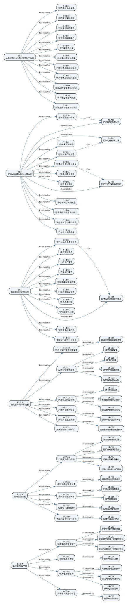

# 11.17SEOV案例

依据2026年11月10日会议纪要、会议收尾逐字稿及《汽车热管理SVOE功能清单（扩充版）》，修改用户上传的11.3案例。日期为2026年11月17日。

本版保留32个原LF编号：31项可分析的核心逻辑功能，另1项后风窗资料缺口占位；规范化原31项场景功能，共62项活动功能。原75条需求记录（3条父需求、41项指标、31项场景功能需求）保留ID。201项扩充功能单独作为候选池，不直接变为正式需求。

建议依次查看：

1. [会议要求落实对照](修改说明与检查/会议要求落实对照.md)与[系统边界、待确认项](修改说明与检查/系统边界与待确认项.md)。
2. [功能树](功能抽取/功能树.md)、功能清单_SEOV.xlsx/json、功能关系.xlsx/json、名称修改对照.xlsx。
3. [字段与命名规范](功能抽取/字段与命名规范.md)、来源路径与证据状态.xlsx、案例推荐动词用法.xlsx。
4. 原布局下的需求图、需求活动图、需求用例图、需求外部BDD图、两张指标表、结构化需求清单与物理组件映射表。
5. 功能模型目录的原子功能定义和六份功能分解SysML；六组逻辑关系SVG/PNG与可重绘DOT源码；场景与功能逻辑目录的说明。
6. 扩充候选功能池_201项.xlsx/json及案例功能与扩充清单映射.json。
7. 修改说明与检查目录的检查报告。

图中的decomposition为分解；sequence为先后；branch/condition为条件；parallel为分析级可并行；feedback为反馈；enables/inhibits为许可/抑制；information_flow为信息依赖。图的边标签不替代功能关系JSON中的具体条件。

来源压缩包、会议文件和扩充清单保存在00_修改依据。旧版PNG已由本版功能树重新绘制。原概要活动图仍表示阶段级行为；原子功能与条件关系以新增功能抽取/功能模型为准。检查报告会区分SysML静态校验、数据一致性检查与未执行的车辆仿真、源理工具验收。

## 进一步核对结果

62条活动功能记录中有4组原ID兼容引用，规范功能为58项；对应关系见兼容ID与规范功能映射.json，场景SysML不重复实例化。三条需求的功能树已保留来源父活动名，source_model_path与source_refs分别提供修改后及输入原模型定位。场景二本次按扩充清单C01/C02/A06采用最高有效电芯温度及<35℃撤销供风的参考基线；未增加滞回，原41项指标数值与文本仍保留。
