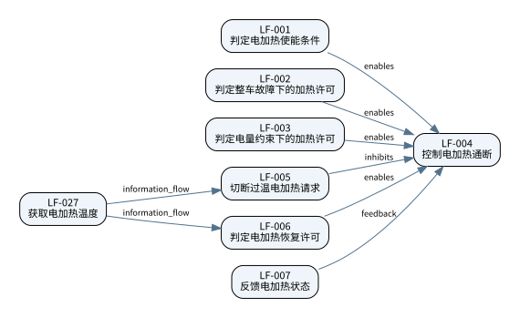

# 3.3.1.2 乘员舱制热控制

以下为分析级契约。原案例约束与本次引用清单细化分别溯源；兼容ID映射不表示重复执行。

## 细分功能

| ID | V+O | 输入（概念） | 输出（概念） |
|---|---|---|---|
| LF-001 | 判定电加热使能条件 | 空气输送状态；目标温度；室内温度；高压可用状态 | 电加热基础许可 |
| LF-002 | 判定整车故障下的加热许可 | 整车故障状态 | 故障约束下的加热许可 |
| LF-003 | 判定电量约束下的加热许可 | 动力电池荷电状态 | 电量约束下的加热许可 |
| LF-004 | 控制电加热通断 | 制热请求；各项加热许可；过温保护状态；恢复许可 | 电加热通断请求 |
| LF-005 | 切断过温电加热请求 | 电加热温度；过温上限 | 过温停热请求 |
| LF-006 | 判定电加热恢复许可 | 电加热温度；恢复阈值；其他使能条件 | 恢复加热许可 |
| LF-007 | 反馈电加热状态 | 电加热通断状态；电加热温度；工作状态；实际功率；最大功率 | 电加热状态信息 |
| LF-027 | 获取电加热温度 | 电加热温度信息 | 电加热温度反馈 |

## 时序与逻辑

| 类型 | 源 | 目标 | 条件/说明 |
|---|---|---|---|
| enables | LF-001 | LF-004 | 全部基础、故障及电量许可按AND合并；其他许可不被替代 |
| enables | LF-002 | LF-004 | 全部基础、故障及电量许可按AND合并；其他许可不被替代 |
| enables | LF-003 | LF-004 | 全部基础、故障及电量许可按AND合并；其他许可不被替代 |
| inhibits | LF-005 | LF-004 | 达到待标定过温上限时切断请求 |
| enables | LF-006 | LF-004 | 降至待标定恢复阈值后允许重新判断全部使能条件；不自动强制加热 |
| information_flow | LF-027 | LF-005 | 温度输入用于过温判断；50 ms为检测周期 |
| information_flow | LF-027 | LF-006 | 温度输入用于恢复许可判断 |
| feedback | LF-007 | LF-004 | 加热控制与状态监测持续运行；反馈不是一次性终点 |
