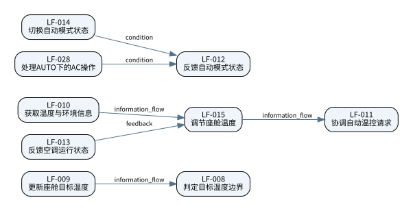

# 3.3.1.6 自动空调控制

以下为分析级契约。原案例约束与本次引用清单细化分别溯源；兼容ID映射不表示重复执行。

## 细分功能

| ID | V+O | 输入（概念） | 输出（概念） |
|---|---|---|---|
| LF-008 | 判定目标温度边界 | 用户设定温度 | 目标温度边界状态 |
| LF-009 | 更新座舱目标温度 | 温度调节操作；当前目标温度 | 更新后的座舱目标温度 |
| LF-010 | 获取温度与环境信息 | 室内温度信息；室外温度信息；日照负荷信息；供热入口温度信息 | 温控所需温度与环境信息 |
| LF-011 | 协调自动温控请求 | 自动模式状态；目标温度；温度与环境信息；可用调节能力 | 送风量请求；送风温度请求；送风模式请求；循环请求；制冷能力请求；电加热功率请求 |
| LF-012 | 反馈自动模式状态 | 当前自动模式状态 | 自动模式状态信息 |
| LF-013 | 反馈空调运行状态 | 风量状态；温度状态；制冷状态；循环状态；送风模式状态；自动模式状态 | 空调运行状态信息 |
| LF-014 | 切换自动模式状态 | 当前模式；用户温度、循环、风量、模式或前除霜操作 | 更新后的模式状态 |
| LF-015 | 调节座舱温度 | 目标温度；实际温度；可用温控能力 | 座舱温控请求 |
| LF-028 | 处理AUTO下的AC操作 | AUTO运行状态；AC按键操作 | 制冷关闭请求；自动模式Close反馈 |

## 时序与逻辑

| 类型 | 源 | 目标 | 条件/说明 |
|---|---|---|---|
| information_flow | LF-009 | LF-008 | 温度设定变化后校核LO/HI边界；边界等值未外推 |
| information_flow | LF-010 | LF-015 | 温度和环境反馈用于调节 |
| information_flow | LF-015 | LF-011 | 温控请求供自动协调 |
| feedback | LF-013 | LF-015 | 控制输出与实际状态需区分；控制算法待确认 |
| condition | LF-014 | LF-012 | 温度/循环操作保持AUTO；风量/模式操作退出AUTO；前除霜操作切至前除霜 |
| condition | LF-028 | LF-012 | AUTO下AC操作反馈Close；其他指定项仍自动 |
