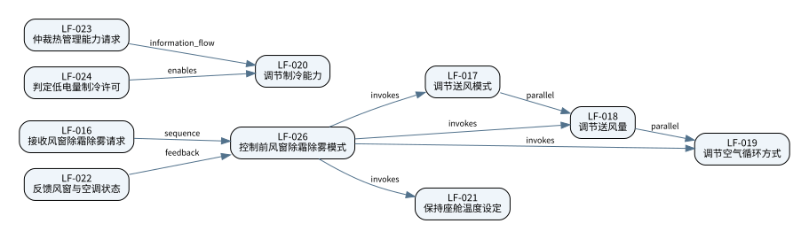

# 3.3.1.9 前风窗除霜除雾控制

以下为分析级契约。原案例约束与本次引用清单细化分别溯源；兼容ID映射不表示重复执行。

## 细分功能

| ID | V+O | 输入（概念） | 输出（概念） |
|---|---|---|---|
| LF-016 | 接收风窗除霜除雾请求 | 用户风窗除霜除雾请求 | 已接收的风窗请求 |
| LF-017 | 调节送风模式 | 风窗模式请求；当前送风模式 | 送风模式请求 |
| LF-018 | 调节送风量 | 风窗模式请求；可用送风能力 | 送风量请求 |
| LF-019 | 调节空气循环方式 | 风窗模式请求；循环设定 | 空气循环请求 |
| LF-020 | 调节制冷能力 | 环境温度条件；除湿需求；制冷许可；能力分配 | 制冷能力请求 |
| LF-021 | 保持座舱温度设定 | 进入模式前的温度设定；用户温度操作 | 当前座舱温度设定 |
| LF-022 | 反馈风窗与空调状态 | 风窗模式状态；风量状态；温度状态；制冷状态；循环状态 | 风窗与空调状态信息 |
| LF-023 | 仲裁热管理能力请求 | 前除霜请求；电池冷却请求；座舱制冷请求；可用能力 | 热管理能力分配 |
| LF-024 | 判定低电量制冷许可 | 动力电池荷电状态；前除霜状态 | 低电量条件下的制冷许可 |
| LF-026 | 控制前风窗除霜除雾模式 | 前除霜除雾请求；当前模式；模式退出操作 | 前风窗除霜除雾控制请求 |

## 时序与逻辑

| 类型 | 源 | 目标 | 条件/说明 |
|---|---|---|---|
| sequence | LF-016 | LF-026 | 接收到前风窗请求后处理模式；后风窗进入待确认项，不沿此前风窗链执行 |
| invokes | LF-026 | LF-017 | 进入对应前风窗模式；各请求无来源指定的严格总顺序 |
| invokes | LF-026 | LF-018 | 进入对应前风窗模式；各请求无来源指定的严格总顺序 |
| invokes | LF-026 | LF-019 | 进入对应前风窗模式；各请求无来源指定的严格总顺序 |
| invokes | LF-026 | LF-021 | 进入对应前风窗模式；各请求无来源指定的严格总顺序 |
| parallel | LF-017 | LF-018 | 同一模式下送风模式和风量协调，分析级可并行；调度待设计 |
| parallel | LF-018 | LF-019 | 同一模式下风量和循环协调，分析级可并行；调度待设计 |
| enables | LF-024 | LF-020 | SOC<10%且前除霜关闭则禁止；前除霜开启则允许；SOC=10%未定义 |
| information_flow | LF-023 | LF-020 | 按SL29继承优先级处理；电池阈值XX不得以35℃替代 |
| feedback | LF-022 | LF-026 | 模式及空调状态持续反馈 |
