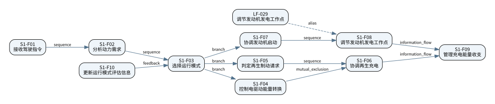

# SC1 串联混动经济性场景

以下为分析级契约。原案例约束与本次引用清单细化分别溯源；兼容ID映射不表示重复执行。

## 细分功能

| ID | V+O | 输入（概念） | 输出（概念） |
|---|---|---|---|
| LF-029 | 调节发动机发电工作点 | 发动机启动状态；负载反馈；转速反馈；发电需求 | 发动机转速目标；发动机负载目标 |
| S1-F01 | 接收驾驶指令 | 加速/制动指令 | 驾驶意图 |
| S1-F02 | 分析动力需求 | 驾驶意图、工况 | 驱动/制动需求 |
| S1-F03 | 选择运行模式 | 动力需求、能源状态 | 驱动/回收/发电请求 |
| S1-F04 | 控制电驱动能量转换 | 驱动请求、可用电能 | 驱动力请求与用电反馈 |
| S1-F05 | 判定再生制动请求 | 制动请求、回收可用性 | 再生请求 |
| S1-F06 | 协调再生充电 | 再生请求、电池充电状态 | 回收能量与充电请求 |
| S1-F07 | 协调发动机启动 | 发电请求、启动状态 | 发动机已启动状态 |
| S1-F08 | 调节发动机发电工作点 | 发动机已启动、负载转速反馈 | 发电电能、负载转速目标 |
| S1-F09 | 管理充电能量收支 | 发电/回收电能、电池状态、驱动消耗 | 充电调度与能耗记录 |
| S1-F10 | 更新运行模式评估信息 | 转速、负载、电池及车辆响应 | 下一步模式评估信息 |

## 时序与逻辑

| 类型 | 源 | 目标 | 条件/说明 |
|---|---|---|---|
| sequence | S1-F01 | S1-F02 | 接收驾驶指令后分析需求 |
| sequence | S1-F02 | S1-F03 | 需求分析先于工作模式选择 |
| branch | S1-F03 | S1-F04 | 驱动需求有效；加速/制动同时有效的仲裁待确认 |
| branch | S1-F03 | S1-F05 | 制动需求有效；再生可用条件待确认 |
| mutual_exclusion | S1-F04 | S1-F06 | 同一牵引电机的驱动与再生制动模式；过渡及制动融合策略待确认 |
| sequence | S1-F05 | S1-F06 | 制动触发且回收可用时请求再生充电 |
| branch | S1-F03 | S1-F07 | 存在发电需求时请求启动；具体启动阈值未提供 |
| sequence | S1-F07 | S1-F08 | 发动机启动完成后调节发电工作点 |
| information_flow | S1-F08 | S1-F09 | 发电能量纳入收支管理 |
| information_flow | S1-F06 | S1-F09 | 回收能量纳入收支管理；避免重复记账 |
| feedback | S1-F10 | S1-F03 | 运行状态反馈用于下一周期模式评估 |
| alias | LF-029 | S1-F08 | 旧指标分配ID与规范场景功能同义引用，不额外执行一次 |
