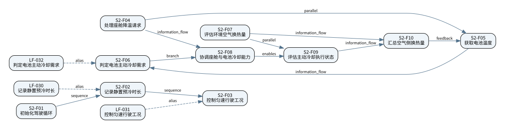

# SC2 空调供风辅助电池冷却场景

以下为分析级契约。原案例约束与本次引用清单细化分别溯源；兼容ID映射不表示重复执行。

## 细分功能

| ID | V+O | 输入（概念） | 输出（概念） |
|---|---|---|---|
| LF-030 | 记录静置预冷时长 | 预冷起点；经过时间 | 静置预冷完成事件 |
| LF-031 | 控制匀速行驶工况 | 预冷完成事件；车速反馈；经过时间 | 车辆目标速度；行驶阶段完成事件 |
| LF-032 | 判定电池主动冷却需求 | 最高有效电芯控制温度 | 电池主动冷却请求 |
| S2-F01 | 初始化驾驶循环 | 仿真开始、空调启动操作 | 静置阶段与座舱降温请求 |
| S2-F02 | 记录静置预冷时长 | 阶段起点、经过时间 | 静置2分钟完成事件 |
| S2-F03 | 控制匀速行驶工况 | 预冷完成事件、车速反馈 | 45 km/h行驶20分钟工况 |
| S2-F04 | 处理座舱降温请求 | 空调启动、座舱状态 | 座舱制冷需求与响应 |
| S2-F05 | 获取电池温度 | 电芯温度快照 | 最高有效电芯温度及有效性 |
| S2-F06 | 判定电池主动冷却需求 | 最高有效电芯控制温度 | 主动冷却请求 |
| S2-F07 | 评估环境空气换热量 | 电池热节点与前舱局部空气状态；独立环境换热边界与有效热导 | 有符号环境换热贡献 |
| S2-F08 | 协调座舱与电池冷却能力 | 两类冷却需求、可用能力 | 各路径能力分配 |
| S2-F09 | 评估主动冷却执行状态 | 电池主动供风请求及供风可用状态；电池入口实际空气温度与流量；主动供风有效热导与独立换热边界 | 未请求、不可用、待供风或供风已建立的执行状态；主动供风的有符号换热贡献 |
| S2-F10 | 汇总空气侧换热量 | 环境/主动换热贡献、车辆与电池运行状态 | 电池/座舱热状态反馈 |

## 时序与逻辑

| 类型 | 源 | 目标 | 条件/说明 |
|---|---|---|---|
| sequence | S2-F01 | S2-F02 | 仿真初始化并启动空调后进入静置预冷 |
| sequence | S2-F02 | S2-F03 | 静置2分钟完成后，以45 km/h行驶20分钟 |
| parallel | S2-F04 | S2-F05 | 座舱温控和电池监测在静置/行驶两阶段均可持续运行 |
| information_flow | S2-F05 | S2-F06 | 按清单C01参考细化，取最高有效电芯控制温度；无有效值处置待确认 |
| branch | S2-F06 | S2-F08 | 最高有效电芯温度>=35℃提出主动供风请求；按清单C02/A06参考细化，<35℃撤销请求，不关闭座舱空调，不新增滞回 |
| information_flow | S2-F04 | S2-F08 | 座舱冷却请求参与冷量协调；不足时优先级待确认 |
| enables | S2-F08 | S2-F09 | 有冷却请求且存在实际可用供风能力；请求不等于执行 |
| parallel | S2-F07 | S2-F09 | 环境对流不由35℃阈值启停；仅在热边界独立时与主动路径并行，若同一表面边界被替换，不重复叠加 |
| information_flow | S2-F07 | S2-F10 | 汇入有符号环境换热量；温差反向时可能向电池传热；仅对独立且无重复计数的热边界求和 |
| information_flow | S2-F09 | S2-F10 | 仅汇入实际供风贡献，不能按请求直接记热；仅对独立且无重复计数的热边界求和 |
| feedback | S2-F10 | S2-F05 | 统一推进热状态；避免对同一热节点重复积分 |
| alias | LF-030 | S2-F02 | 旧指标分配ID与规范场景功能同义引用，不额外执行一次 |
| alias | LF-031 | S2-F03 | 旧指标分配ID与规范场景功能同义引用，不额外执行一次 |
| alias | LF-032 | S2-F06 | 旧指标分配ID与规范场景功能同义引用，不额外执行一次 |

本次结合清单C01/C02/A06参考细化最高有效电芯温度，以及低于35℃撤销请求；这部分不是原11.3条目已经明确的规则。没有引入额外滞回。供风与环境路径必须独立计热；空调风替换同一表面环境空气时更新该边界，不能按两个独立路径重复叠加。
