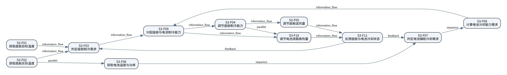

# SC3 座舱空调与Chiller电池液冷场景

以下为分析级契约。原案例约束与本次引用清单细化分别溯源；兼容ID映射不表示重复执行。

## 细分功能

| ID | V+O | 输入（概念） | 输出（概念） |
|---|---|---|---|
| S3-F01 | 获取座舱目标温度 | 人员设定或场景目标 | 有效目标温度 |
| S3-F02 | 获取座舱实际温度 | 座舱温度信息 | 温度反馈 |
| S3-F03 | 判定座舱制冷需求 | 目标温度、实测温度 | 座舱制冷需求 |
| S3-F04 | 调节座舱制冷能力 | 分配的制冷能力、制冷需求 | 制冷量调节请求 |
| S3-F05 | 调节座舱送风量 | 制冷请求、空气输送需求 | 座舱空气换热效果 |
| S3-F06 | 获取电池温度与功率 | 电池温度、充放电功率 | 有效温度/功率输入 |
| S3-F07 | 判定电池辅助冷却需求 | 温度/功率输入 | 辅助冷却需求 |
| S3-F08 | 计算电池冷却能力需求 | 辅助冷却需求、热状态 | 电池冷却能力请求 |
| S3-F09 | 分配座舱与电池制冷能力 | 座舱/电池请求、可用制冷能力 | 两个功能的能力分配 |
| S3-F10 | 调节电池液路换热量 | 电池分配能力、冷却液状态 | 电池热量交换响应 |
| S3-F11 | 反馈座舱与电池冷却状态 | 座舱/电池温度与执行状态 | 需求重新评估信息 |

## 时序与逻辑

| 类型 | 源 | 目标 | 条件/说明 |
|---|---|---|---|
| information_flow | S3-F01 | S3-F03 | 目标温度参与制冷需求判断 |
| information_flow | S3-F02 | S3-F03 | 实际温度参与制冷需求判断；控制死区未给出 |
| information_flow | S3-F03 | S3-F09 | 座舱制冷请求参与分配 |
| parallel | S3-F02 | S3-F06 | 座舱温度与电池温度/功率监测可并行 |
| sequence | S3-F06 | S3-F07 | 温度偏高OR充放电功率较大；具体阈值待确认 |
| sequence | S3-F07 | S3-F08 | 辅助冷却需求成立时计算冷量请求 |
| information_flow | S3-F08 | S3-F09 | 电池冷却请求参与分配；不得套用场景二35℃ |
| information_flow | S3-F09 | S3-F04 | 按座舱分配能力调节，能力不足策略待确认 |
| information_flow | S3-F09 | S3-F10 | 按电池分配能力调节冷却液—Chiller路径，不改为风冷或直冷 |
| parallel | S3-F04 | S3-F10 | 能力足够且两路均有需求时可同时运行；互斥策略未规定 |
| information_flow | S3-F04 | S3-F05 | 制冷与送风共同形成座舱空气换热条件 |
| information_flow | S3-F05 | S3-F11 | 实际座舱温控状态参与反馈 |
| information_flow | S3-F10 | S3-F11 | 实际液冷状态参与反馈 |
| feedback | S3-F11 | S3-F03 | 反馈更新座舱冷却需求 |
| feedback | S3-F11 | S3-F07 | 反馈更新电池冷却需求 |
