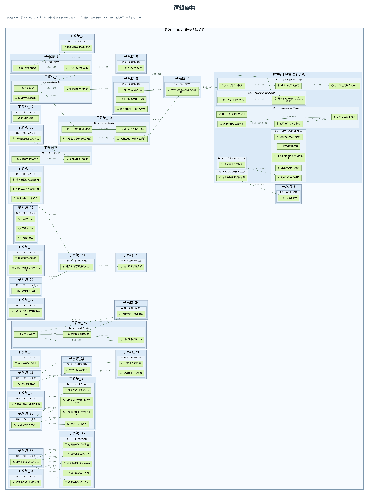

# 动力电池热管理逻辑架构案例

本图依据用户提供的聚类结果 JSON 生成，包含 **70 个功能、36 个功能簇、43 条关系**，用于展示当前功能分组与关系，属于逻辑架构阶段性初稿。

## 文件

- [高清 SVG](逻辑架构.svg)：适合放大查看。
- [PNG 图片](逻辑架构.png)：适合预览和插入汇报。
- [Graphviz DOT 源文件](逻辑架构.dot)：用于编辑节点、关系及布局；顶部标题在 SVG/PNG 导出阶段添加。

## 读图说明

浅蓝容器表示原始 JSON 中的子系统及功能簇，浅绿色矩形表示功能。实线箭头表示依赖，箭头由依赖方指向被依赖方；虚线表示互斥、互斥条件分支、互斥选择或竞争，具体类型以连线标签为准，不表示执行顺序。L-001 至 L-043 按原始 clustered_relations 数组顺序编号。

原始关系包含：31 条依赖、1 条互斥、3 条互斥条件分支、3 条互斥选择、5 条竞争。类型名称沿用原始数据，未进行业务重分类。

子系统名称和分组沿用原始数据，不代表已完成工程职责边界确认。未补造原数据缺失的端口、流对象或输入输出接口；连线不等同于已确认的数据流。子系统职责、输入输出及接口契约仍需结合原始功能模型进一步核对。

原始 JSON 未上传至本仓库。
