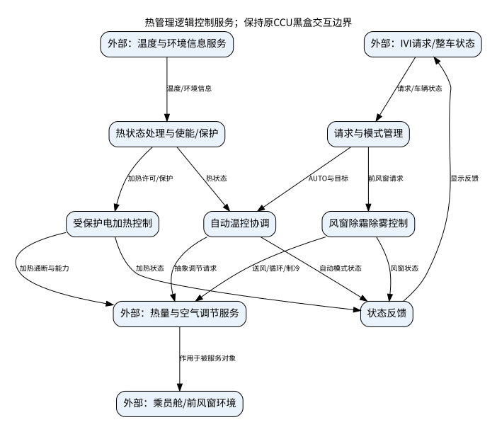

# 系统边界与物理组件逻辑化表达

## 1. 依据及视角选择

主依据为备份中的《热管理物理实体清单与系统边界分析.md》§0—§4，并核对SL29 §3、§4.6.3及原BDD、ACT、UC、RD。原边界文件的SL29子系统级物理口径，将CCU直接驱动/采集的回路器件列为内部；本批8个模型却采用更窄的“CCU热管理控制功能”黑盒，原BDD把执行器组、传感器组打包列在系统之外。两种视角必须分开，不能无说明把执行器搬入或把温度采集功能删除。

本批模型继续保持原黑盒接口边界，将目标命名为“热管理逻辑控制服务”。其内部设计职责为请求/模式管理、热状态处理、加热许可与保护、自动温控协调、风窗除霜除雾、状态反馈。外部温度/执行实体改为抽象的信息提供与热量空气调节服务，表示逻辑交互角色，不能据此判定其物理硬件供货归属。

另给出SL29较宽口径的77项逐项映射表：系统侧物理实现映射到对应逻辑行为；外部对象保留外部角色；争议项不强行归属。源文件的“内部33项/外部24项”是聚合口径，不能与77个逐项编号简单相加检查。

## 2. 内部逻辑职责与外部角色

|视角|对象/职责|本批处理|
|---|---|---|
|逻辑控制服务内部|用户请求、模式协调、信息处理、受保护加热、温控、前风窗控制、反馈|以逻辑功能命名；不设计压缩机、风扇、冷板或传感器硬件|
|外部人及系统|驾驶员/乘员、IVI、整车状态/电源管理、通信网络|保留原参与者和请求/反馈链路；CAN为交互基础设施|
|外部被服务对象|电池包、电机、乘员舱、风窗|保留其温度、功率和换热交互，不把对象本体当控制服务内部硬件|
|外部信息与执行角色|温度与环境信息提供服务、热量与空气调节执行服务|保留原BDD全部端口特征和流；执行通断/转速仍可作为技术接口信息|
|较宽SL29功能口径|流量调节、换热、散热、电加热、送风、模式/温度/循环调节、状态采集|物理实现不作为逻辑设计对象；见77项映射表|

## 3. 典型逻辑化及保真

空调压缩机→制冷能力调节；鼓风机→空气输送与风量调节；冷热风门→送风温度调节；模式风门→送风模式调节；循环风门→循环方式调节；PTC及继电器→电加热能力/通断/过温保护；温度传感器→温度信息获取。电池冷板→电池换热接口/作用，不以内部冷板part裁定其归属。

保留的转速接口单位r/min、技术信号ptcEnable等是接口语义及追溯标识，不是内部硬件实例。不能为了去物理名删除SOC>10%、温度比较、1000 r/min待标定等原始约束。原始硬件用语完整保留于备份、原指标文本和映射表。

## 4. 争议清单

EAC独立控制器/总成边界、电池冷板、后排送风配置、后风窗加热、ZCU/CVC/CCU部署、窄口径送风风门服务位置、电机散热回路推得项均保持待确认；AQS/AUC仅为公开参考，不纳入本项目正式设计。原清单将电池冷板倾向外部，但同时列为争议，本批不将该倾向冻结为决定。

## 5. 模型更新范围

原3份RD：20个子需求短ID不变，补齐逻辑化约束文本。原3份ACT：保留活动/阶段顺序，名称和行为改为逻辑服务表达，纠正AUTO下AC操作反馈遗漏。原UC：保留3个用例、参与者及require关系。原BDD：保留端口/特征/接口/流/连接，改变目标及交互角色名称，不删除原接口。新增逻辑功能架构及41项独立指标需求。逐文件diff可查看全部修改。

ACT沿用原模型以高层动作doc表达条件与持续行为的方式，动作完成并非意味着监测/保护停止；不是可执行控制器。三个新增场景另用显式标签活动图和关系表表达条件、并行、互斥与闭环；不把原ACT的单次阶段遍历当仿真算法。

