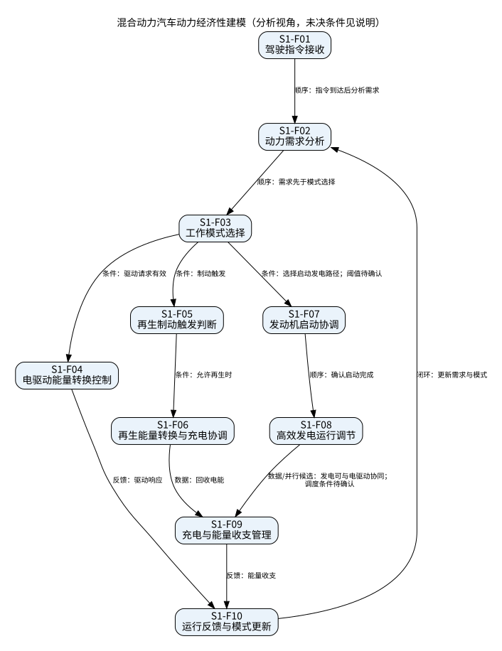

# 混合动力汽车动力经济性建模

## 场景描述

串联混动在标准工况下模拟驱动、制动与发电协同。发动机不直接机械驱动车辆；启动/发电角色与驱动/再生角色区分，专属电机角色需原模型确认。

依据：任务书§5.2。输入输出是分析层信息契约；未知控制算法不作为既定设计。一级功能及分解如下。

|功能ID|一级功能|细分功能|输入|输出|限制|
|---|---|---|---|---|---|
|S1-F01|驾驶需求识别|驾驶指令接收|加速/制动指令|驾驶意图|输入同时有效时仲裁待确认|
|S1-F02|驾驶需求识别|动力需求分析|驾驶意图、工况|驱动/制动需求|需求先于模式选择|
|S1-F03|模式协调|工作模式选择|动力需求、能源状态|驱动/回收/发电请求|启动和停机阈值未给出|
|S1-F04|车辆驱动|电驱动能量转换控制|驱动请求、可用电能|驱动力请求与用电反馈|发动机不直接机械驱动|
|S1-F05|制动回收|再生制动触发判断|制动请求、回收可用性|再生请求|回收上限及摩擦制动融合待确认|
|S1-F06|制动回收|再生能量转换与充电协调|再生请求、电池充电状态|回收能量与充电请求|受电池接受能力约束，数值未给出|
|S1-F07|启动与发电|发动机启动协调|发电请求、启动状态|发动机已启动状态|启动完成先于发电控制|
|S1-F08|启动与发电|高效发电运行调节|发动机已启动、负载转速反馈|发电电能、负载转速目标|最优转速区间未给出；优先维持50%以上负载|
|S1-F09|能量管理|充电与能量收支管理|发电/回收电能、电池状态、驱动消耗|充电调度与能耗记录|发电和回收能量不得重复记账|
|S1-F10|能量管理|运行反馈与模式更新|转速、负载、电池及车辆响应|下一步模式评估信息|闭环周期与控制算法待确认|

## 时序与逻辑关系

|前项|后项|关系|条件/交互|
|---|---|---|---|
|S1-F01|S1-F02|顺序|指令到达后分析需求|
|S1-F02|S1-F03|顺序|需求先于模式选择|
|S1-F03|S1-F04|条件|驱动请求有效|
|S1-F03|S1-F05|条件|制动触发|
|S1-F05|S1-F06|条件|允许再生时|
|S1-F03|S1-F07|条件|选择启动发电路径；阈值待确认|
|S1-F07|S1-F08|顺序|确认启动完成|
|S1-F08|S1-F09|数据/并行候选|发电可与电驱动协同；调度条件待确认|
|S1-F06|S1-F09|数据|回收电能|
|S1-F04|S1-F10|反馈|驱动响应|
|S1-F09|S1-F10|反馈|能量收支|
|S1-F10|S1-F02|闭环|更新需求与模式|

## 条件、并行、互斥与反馈

驱动正扭矩与再生负扭矩在同一驱动通道同时刻按模式互斥，具体过渡策略待确认；不能将发电与驱动设为全局互斥。发动机负载目标是效率偏好，不是任何情况下的硬下限。发动机最优转速、SOC切换阈值、启动时长和电池充电限值均未给出。 50%以上负载仅按原文保留，不能将发动机效率偏好变成强制下限。

图中箭头含义以标签为准：有顺序、数据、条件、反馈和并行候选，不把数据依赖误作严格时序。

## 本次增量复核

保留本场景功能ID及原有关系，不将分析动作自动视为新产品需求。功能清单中的SC记录是任务书分析结果；场景工况值与产品性能指标分开管理。并行候选只表示可分支计算/协调，不承诺未知资源条件下能同时足额执行。图中的数据依赖和先后执行以标签区分；未知优先级和控制门限保持待确认。
