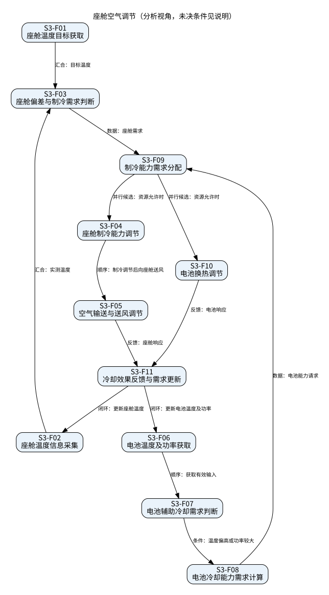

# 座舱空气调节

## 场景描述

电动汽车仿真中的座舱温控及辅助电池冷却。通过制冷能力调节控制座舱温度；电池温度偏高或充放电功率较大时请求辅助冷却。除湿/除霜仅为可扩展能力。

依据：任务书§5.4。输入输出是分析层信息契约；未知控制算法不作为既定设计。一级功能及分解如下。

|功能ID|一级功能|细分功能|输入|输出|限制|
|---|---|---|---|---|---|
|S3-F01|座舱温控|座舱温度目标获取|人员设定或场景目标|有效目标温度|默认目标温度未提供|
|S3-F02|座舱温控|座舱温度信息采集|座舱温度信息|温度反馈|采样精度未规定|
|S3-F03|座舱温控|座舱偏差与制冷需求判断|目标温度、实测温度|座舱制冷需求|控制死区与算法待确认|
|S3-F04|座舱温控|座舱制冷能力调节|分配的制冷能力、制冷需求|制冷量调节请求|不用压缩机等硬件作功能名称|
|S3-F05|座舱温控|空气输送与送风调节|制冷请求、空气输送需求|座舱空气换热效果|风量上下限未给出|
|S3-F06|辅助电池冷却|电池温度及功率获取|电池温度、充放电功率|有效温度/功率输入|不能将场景二35℃自动移用于本场景|
|S3-F07|辅助电池冷却|电池辅助冷却需求判断|温度/功率输入|辅助冷却需求|温度偏高 OR 功率较大；阈值未给出|
|S3-F08|辅助电池冷却|电池冷却能力需求计算|辅助冷却需求、热状态|电池冷却能力请求|热模型参数及计算算法未给出|
|S3-F09|资源协同|制冷能力需求分配|座舱/电池请求、可用制冷能力|两个功能的能力分配|不足时优先级/互斥策略待确认|
|S3-F10|辅助电池冷却|电池换热调节|电池分配能力、冷却液状态|电池热量交换响应|保留原场景冷却液路径，未改为供风|
|S3-F11|闭环反馈|冷却效果反馈与需求更新|座舱/电池温度与执行状态|需求重新评估信息|不得凭空填写安全/性能窗口上下限|

## 时序与逻辑关系

|前项|后项|关系|条件/交互|
|---|---|---|---|
|S3-F01|S3-F03|汇合|目标温度|
|S3-F02|S3-F03|汇合|实测温度|
|S3-F03|S3-F09|数据|座舱需求|
|S3-F06|S3-F07|顺序|获取有效输入|
|S3-F07|S3-F08|条件|温度偏高或功率较大|
|S3-F08|S3-F09|数据|电池能力请求|
|S3-F09|S3-F04|并行候选|资源允许时|
|S3-F09|S3-F10|并行候选|资源允许时|
|S3-F04|S3-F05|顺序|制冷调节后向座舱送风|
|S3-F05|S3-F11|反馈|座舱响应|
|S3-F10|S3-F11|反馈|电池响应|
|S3-F11|S3-F02|闭环|更新座舱温度|
|S3-F11|S3-F06|闭环|更新电池温度及功率|

## 条件、并行、互斥与反馈

座舱与电池两条需求链可以并行计算；是否同时提供足额冷量取决于可用能力，不能无条件宣称并行执行有保障。资源不足只标记需要协调，未给出座舱优先或电池优先的既定策略。未规定硬互斥；除湿除霜不进入本次必需功能或量化指标。 项目SL29 4.1.3.3已规定前除霜>电池降温(达到阈值)>座舱制冷>电池降温(未达阈值)，同时定义需求转速叠加及最大转速饱和。此为有条件的项目规则；场景三没有给出其电池阈值和模式适用性，不能直接按35℃实施该规则。

图中箭头含义以标签为准：有顺序、数据、条件、反馈和并行候选，不把数据依赖误作严格时序。

## 本次增量复核

保留本场景功能ID及原有关系，不将分析动作自动视为新产品需求。功能清单中的SC记录是任务书分析结果；场景工况值与产品性能指标分开管理。并行候选只表示可分支计算/协调，不承诺未知资源条件下能同时足额执行。图中的数据依赖和先后执行以标签区分；未知优先级和控制门限保持待确认。
