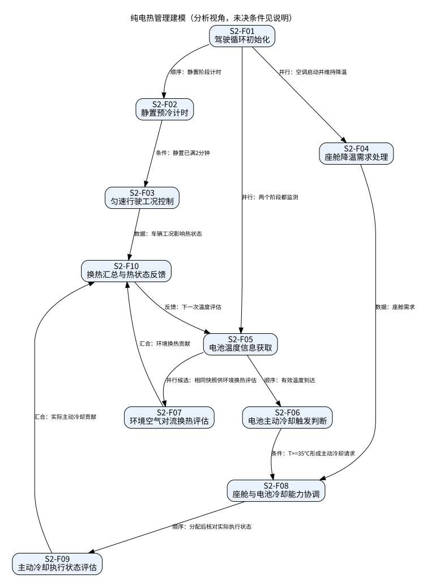

# 纯电热管理建模

## 场景描述

集成空调与分块电池的纯电多系统仿真：先静置开空调2分钟，再以45 km/h匀速行驶20分钟。环境换热持续参与；电芯温度达到或超过35℃时引入空调主动冷却。

依据：任务书§5.3。输入输出是分析层信息契约；未知控制算法不作为既定设计。一级功能及分解如下。

|功能ID|一级功能|细分功能|输入|输出|限制|
|---|---|---|---|---|---|
|S2-F01|工况执行|驾驶循环初始化|仿真开始、空调启动操作|静置阶段与座舱降温请求|初始温度、时间步长未给出|
|S2-F02|工况执行|静置预冷计时|阶段起点、经过时间|静置2分钟完成事件|不可省略座舱空调启动|
|S2-F03|工况执行|匀速行驶工况控制|预冷完成事件、车速反馈|45 km/h行驶20分钟工况|总循环22分钟由2+20推导，不新增指标|
|S2-F04|座舱温控|座舱降温需求处理|空调启动、座舱状态|座舱制冷需求与响应|目标温度未提供|
|S2-F05|电池温控|电池温度信息获取|电芯温度快照|有效温度输入|控制温度取最大/均值未规定|
|S2-F06|电池温控|电池主动冷却触发判断|电芯温度|主动冷却请求|T>=35℃触发；退出回差未提供|
|S2-F07|环境换热|环境空气对流换热评估|电芯与发动机舱空气状态、换热条件|有符号环境换热贡献|温差可能反向，不能总假定降温|
|S2-F08|资源协同|座舱与电池冷却能力协调|两类冷却需求、可用能力|各路径能力分配|不足时优先级待确认|
|S2-F09|主动冷却|主动冷却执行状态评估|冷却请求、分配能力及热状态|实际冷却贡献及效果反馈|请求不等于已形成实际冷量；延迟及不可用处理待确认|
|S2-F10|闭环反馈|换热汇总与热状态反馈|环境/主动换热贡献、车辆与电池运行状态|电池/座舱热状态反馈|统一推进状态，避免两次积分|

## 时序与逻辑关系

|前项|后项|关系|条件/交互|
|---|---|---|---|
|S2-F01|S2-F02|顺序|静置阶段计时|
|S2-F02|S2-F03|条件|静置已满2分钟|
|S2-F01|S2-F04|并行|空调启动并维持降温|
|S2-F01|S2-F05|并行|两个阶段都监测|
|S2-F05|S2-F06|顺序|有效温度到达|
|S2-F05|S2-F07|并行候选|相同快照供环境换热评估|
|S2-F06|S2-F08|条件|T>=35℃形成主动冷却请求|
|S2-F04|S2-F08|数据|座舱需求|
|S2-F08|S2-F09|顺序|分配后核对实际执行状态|
|S2-F07|S2-F10|汇合|环境换热贡献|
|S2-F09|S2-F10|汇合|实际主动冷却贡献|
|S2-F10|S2-F05|反馈|下一次温度评估|
|S2-F03|S2-F10|数据|车辆工况影响热状态|

## 条件、并行、互斥与反馈

静置阶段和匀速行驶阶段按阶段状态互斥；温控、运行与监测可以并行。被动换热和主动冷却不是天然互斥，可同时贡献换热；不得在达到35℃后删除环境换热。对T<35℃不擅自规定退出回差或冷却关闭条件。任务书称发动机舱空气，与纯电命名存在语境疑问，原文保留待核实。 SL29 4.1.3.3存在项目级制冷优先级及转速叠加/饱和规则，但电池优先阈值XX未定，不能用场景35℃替代；是否移植该项目控制策略到本仿真需确认。

图中箭头含义以标签为准：有顺序、数据、条件、反馈和并行候选，不把数据依赖误作严格时序。
