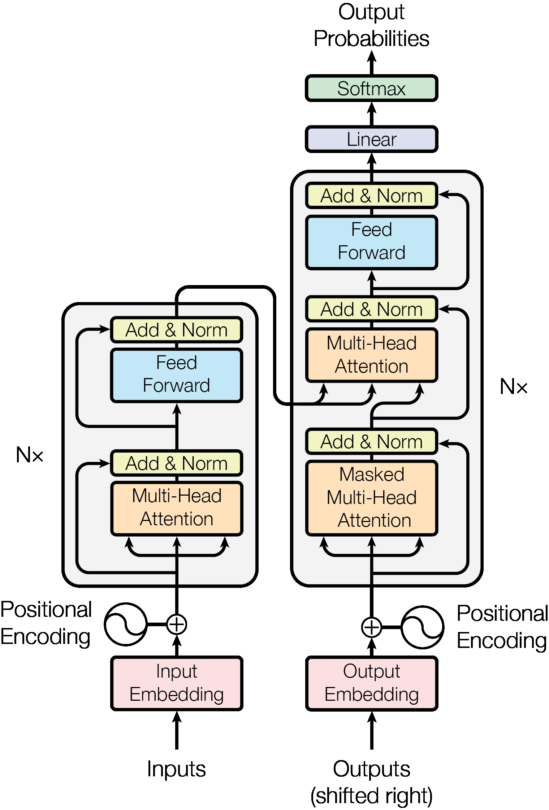
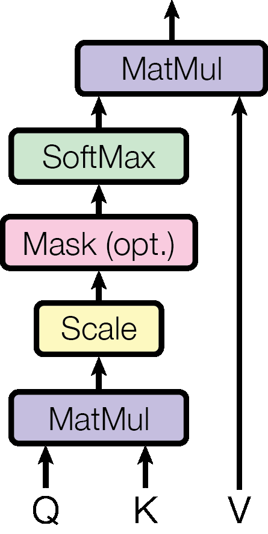
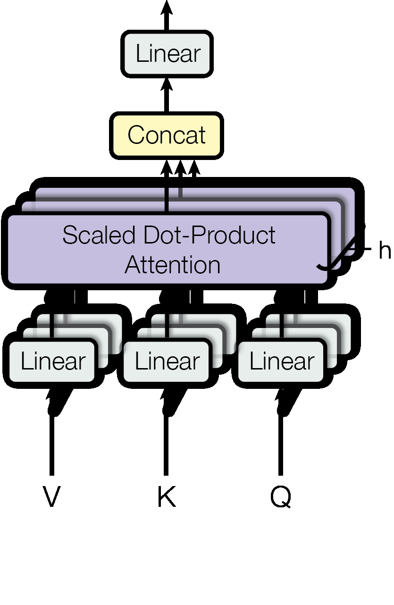

# Attention Is All You Need｜《注意力就是你所需要的一切》

**NIPS 2017会议版中文全译 · 学习译本**

作者：Ashish Vaswani、Noam Shazeer、Niki Parmar、Jakob Uszkoreit、Llion Jones、Aidan N. Gomez、Łukasz Kaiser、Illia Polosukhin。

单位：Google Brain、Google Research、多伦多大学等；作者署名、单位及联系邮箱见原文首页。

译本依据：用户上传的11页《NIPS-2017-attention-is-all-you-need-Paper.pdf》。保持原文章节、公式编号、引用编号及实验数值；正文按原文段落翻译。图1、图2保留原图并附中文图注；表1—表3用中文重排。参考文献保留英文书目信息，另附中文题名。补充理解提示集中在配套思维导图说明中，不混入作者论述。本文件不包含其他修订版新增内容；上传文件本身未附注意力可视化附录。

## 摘要

占主导地位的序列转换模型建立在复杂的循环神经网络或卷积神经网络之上，包含编码器和解码器。表现最好的模型还通过注意力机制连接编码器与解码器。我们提出一种新的、简单的网络架构Transformer，它完全基于注意力机制，彻底摒弃循环与卷积。在两项机器翻译任务上的实验表明，这些模型在质量上更优，同时更易于并行化，所需训练时间也显著减少。我们的模型在WMT 2014英译德任务上取得28.4 BLEU，比包括集成模型在内的已有最佳结果提高超过2 BLEU。在WMT 2014英译法任务上，我们的模型使用8块GPU训练3.5天后，取得新的单模型最佳水平：41.0 BLEU，其训练成本仅为文献中最佳模型的一小部分。

## 1 引言

循环神经网络，尤其是长短期记忆网络（LSTM）[12]和门控循环神经网络[7]，已经牢固确立为语言建模、机器翻译等序列建模与序列转换问题的先进方法[29,2,5]。此后，大量研究持续推进循环语言模型和编码器—解码器架构的能力边界[31,21,13]。

循环模型通常沿输入、输出序列中符号所在的位置分解计算。它们把序列位置对应到计算时间步，根据前一个隐藏状态hₜ₋₁和位置t的输入生成隐藏状态hₜ序列。这种固有的顺序性使单个训练样本内部无法并行计算。当序列较长时，这一问题尤为关键，因为内存约束限制了通过增加样本批量来并行化的空间。近期工作利用因子分解技巧[18]和条件计算[26]显著提高了计算效率，后者还改善了模型性能。然而，顺序计算这一根本限制依然存在。

注意力机制已经成为许多任务中高性能序列建模与序列转换模型的重要组成部分，使模型能够建立依赖关系，而不受这些关系在输入或输出序列中的距离影响[2,16]。不过，除少数情况[22]外，这些注意力机制通常与循环网络配合使用。

本文提出Transformer：一种不使用循环、完全依靠注意力机制建立输入和输出之间全局依赖的模型架构。Transformer允许显著更多的并行计算，在8块P100 GPU上训练仅约12小时，就能达到新的最佳翻译质量。

### 首页作者脚注

带星号的作者贡献相同，署名顺序随机。Jakob提出用自注意力替代RNN，并启动了对这一想法的评估。Ashish与Illia设计、实现了最初的Transformer模型，Ashish深入参与了工作的各个方面。Noam提出缩放点积注意力、多头注意力及无参数的位置表示，几乎参与了全部细节。Niki在最初代码库及tensor2tensor中设计、实现、调试和评估了大量模型变体。Llion也探索了新模型变体，负责最初代码库、高效推理及可视化。Łukasz和Aidan投入大量时间设计和实现tensor2tensor的不同部分，以其替代早期代码库，大幅改善结果并加速研究。

Aidan N. Gomez的相关工作在Google Brain期间完成；Illia Polosukhin的相关工作在Google Research期间完成。

会议：第31届神经信息处理系统大会，NIPS 2017，美国加利福尼亚州长滩。

## 2 背景

减少顺序计算也是Extended Neural GPU[20]、ByteNet[15]和ConvS2S[8]的基础目标。这些方法均以卷积神经网络为基本构件，并行计算所有输入和输出位置的隐藏表示。在这些模型中，建立任意两个输入或输出位置之间联系所需的操作数，会随位置距离增长：ConvS2S中呈线性增长，ByteNet中呈对数增长。这使远距离依赖更难学习[11]。Transformer把这一操作数降低为常数，但由于对注意力加权的位置进行平均，会降低有效分辨率。我们通过第3.2节介绍的多头注意力抵消这一影响。

自注意力有时也称为内部注意力（intra-attention），它通过关联同一序列的不同位置来计算序列表示。自注意力已成功应用于阅读理解、生成式摘要、文本蕴含，以及与任务无关的句子表示学习等任务[4,22,23,19]。

端到端记忆网络采用循环式注意力机制，而不是与序列位置对齐的循环计算，在简单语言问答和语言建模任务中表现良好[28]。

然而，据我们所知，Transformer是第一个完全依靠自注意力计算输入和输出表示、不使用与序列位置对齐的RNN或卷积的序列转换模型。下文将介绍Transformer，阐述使用自注意力的动机，并讨论其相对于[14,15,8]等模型的优势。

## 3 模型架构

大多数有竞争力的神经序列转换模型采用编码器—解码器结构[5,2,29]。编码器把输入符号表示序列(x₁,…,xₙ)映射为连续表示序列z=(z₁,…,zₙ)。给定z，解码器每次生成一个符号，逐步形成输出序列(y₁,…,yₘ)。每一步都是自回归的[9]：生成下一个符号时，将此前生成的符号作为额外输入。

Transformer沿用这一总体架构，在编码器和解码器中均使用堆叠的自注意力与逐位置全连接层，分别如图1左半部分和右半部分所示。



**图1：Transformer模型架构。** 左侧为编码器，右侧为解码器。原图标签对应：Input/Output Embedding＝输入/输出嵌入；Positional Encoding＝位置编码；Multi-Head Attention＝多头注意力；Masked Multi-Head Attention＝掩码多头注意力；Feed Forward＝前馈网络；Add & Norm＝残差相加与层归一化；Outputs (shifted right)＝右移的目标输出；Output Probabilities＝输出概率。图像保留原文，不把学习重绘图混作论文原图。

### 3.1 编码器与解码器堆叠

**编码器。** 编码器由N=6个结构相同的层堆叠而成。每层有两个子层：第一个是多头自注意力机制，第二个是简单的逐位置全连接前馈网络。两个子层都采用残差连接[10]，随后进行层归一化[1]。也就是说，每个子层的输出为：

```text
LayerNorm(x + Sublayer(x))
```

其中Sublayer(x)表示该子层自身实现的函数。为便于残差连接，模型所有子层以及嵌入层的输出维度均为d_model=512。

**解码器。** 解码器同样由N=6个结构相同的层堆叠而成。除编码器每层的两个子层外，解码器还插入第三个子层，对编码器堆叠的输出执行多头注意力。与编码器类似，每个子层都采用残差连接，随后进行层归一化。我们还修改了解码器中的自注意力子层，防止某个位置关注其后的位置。这种掩码与向后偏移一个位置的输出嵌入相结合，确保对位置i的预测只能依赖位置小于i的已知输出。

### 3.2 注意力

注意力函数可以描述为：将一个查询（query）和一组键—值（key-value）对映射为一个输出，其中查询、键、值和输出都是向量。输出是各个值的加权和，每个值的权重由查询与相应键之间的相容性函数计算得到。

### 3.2.1 缩放点积注意力

我们将所采用的注意力称为“缩放点积注意力”（图2）。输入包括维度为dₖ的查询和键，以及维度为dᵥ的值。先计算查询与所有键的点积，再分别除以√dₖ，然后应用Softmax函数，得到作用于各个值的权重。

实际计算时，把一组查询组织为矩阵Q，一次同时计算；键和值分别组织为矩阵K和V。输出矩阵为：

```text
Attention(Q,K,V) = softmax(QKᵀ / √dₖ)V                         (1)
```

最常用的两类注意力函数是加性注意力[2]和点积（乘性）注意力。除缩放因子1/√dₖ之外，点积注意力与我们的算法相同。加性注意力使用一个带单隐藏层的前馈网络计算相容性函数。二者理论复杂度相近，但点积注意力可以利用高度优化的矩阵乘法代码，因此实际计算更快、更节省存储空间。

当dₖ较小时，两种机制表现接近；当dₖ较大时，加性注意力优于未经缩放的点积注意力[3]。我们推测，较大的dₖ使点积的数值幅度增大，将Softmax推入梯度极小的区域。为抵消这种影响，我们将点积乘以1/√dₖ。

原文脚注4：为说明点积为何随维度增大，假设q、k的各分量是均值为0、方差为1的独立随机变量，则点积q·k=Σᵢqᵢkᵢ的均值为0、方差为dₖ。





**图2：** 左侧为缩放点积注意力；右侧为多头注意力，由多个并行运行的注意力层组成。原图中MatMul＝矩阵乘法；Scale＝缩放；Mask (opt.)＝掩码（可选）；Concat＝拼接；Linear＝线性变换。

### 3.2.2 多头注意力

我们发现，相比直接对d_model维的查询、键和值执行一次注意力计算，先用不同的可学习线性投影，将它们分别投影h次到dₖ、dₖ和dᵥ维更有益。随后在每组投影后的查询、键和值上并行执行注意力函数，得到dᵥ维的输出。将这些输出拼接起来，再进行一次投影，得到最终输出，如图2所示。

多头注意力使模型能够同时关注不同位置、不同表示子空间的信息。单个注意力头的平均操作会抑制这种能力。

```text
MultiHead(Q,K,V) = Concat(head₁,…,headₕ)Wᴼ
headᵢ = Attention(QWᵢQ, KWᵢK, VWᵢV)
```

其中投影参数矩阵的形状为：

```text
WᵢQ ∈ ℝ^(d_model × dₖ)      WᵢK ∈ ℝ^(d_model × dₖ)
WᵢV ∈ ℝ^(d_model × dᵥ)      Wᴼ  ∈ ℝ^(h·dᵥ × d_model)
```

本文使用h=8个并行注意力层，也称为“头”。每个头采用dₖ=dᵥ=d_model/h=64。由于每头维度减小，总计算成本与全维度的单头注意力相近。

### 3.2.3 注意力在模型中的三种应用

- **编码器—解码器注意力。** 查询来自解码器前面的层，记忆的键和值来自编码器输出。这使解码器的每个位置都能关注输入序列的所有位置，其作用类似于序列到序列模型[31,2,8]中的典型编码器—解码器注意力。
- **编码器自注意力。** 键、值和查询都来自同一处，即编码器前一层的输出。编码器每个位置都能关注前一层的所有位置。
- **解码器自注意力。** 解码器每个位置可以关注截至并包含当前位置的所有解码器位置。为保持自回归性质，必须防止解码器中的信息从右向左流动。我们在缩放点积注意力内部实现这一限制：把Softmax输入中对应非法连接的数值设为负无穷。见图2。

### 3.3 逐位置前馈网络

除注意力子层外，编码器和解码器的每一层还包含一个全连接前馈网络。它分别、以相同方式应用于每个位置，由两个线性变换和位于二者之间的ReLU激活组成：

```text
FFN(x) = max(0, xW₁ + b₁)W₂ + b₂                            (2)
```

同一层中，不同位置采用相同的线性变换；不同层之间则使用不同参数。也可以将其理解为两个卷积核大小为1的卷积。输入与输出维度均为d_model=512，中间层维度为d_ff=2048。

### 3.4 嵌入与Softmax

与其他序列转换模型类似，我们使用可学习嵌入，将输入和输出词元转换成d_model维向量。也使用常见的可学习线性变换与Softmax，将解码器输出转换为下一个词元的预测概率。

在模型中，两个嵌入层与Softmax之前的线性变换共享同一个权重矩阵，做法类似于[24]。在嵌入层中，我们将这些权重乘以√d_model。

### 3.5 位置编码

由于模型不包含循环或卷积，要使模型利用序列顺序，必须注入词元在序列中的相对位置或绝对位置信息。为此，我们在编码器和解码器堆叠底部的输入嵌入中加入“位置编码”。位置编码与嵌入具有相同维度d_model，因此可以直接相加。位置编码有多种选择，包括可学习形式和固定形式[8]。

本文采用不同频率的正弦和余弦函数：

```text
PE(pos,2i)   = sin(pos / 10000^(2i/d_model))
PE(pos,2i+1) = cos(pos / 10000^(2i/d_model))
```

其中pos表示位置，i用于索引成对的维度。每个位置编码维度对应一个正弦曲线，波长按几何级数从2π变化到10000·2π。我们选择该函数，是因为推测模型可以较容易地学会基于相对位置进行注意力匹配：对于任意固定偏移量k，PE(pos+k)都可以表示为PE(pos)的线性函数。

我们也试验了可学习位置嵌入[8]，发现两种版本的结果几乎相同，见表3(E)。选择正弦版本，是因为它可能允许模型外推到超过训练时所见长度的序列。

## 4 为什么使用自注意力

本节比较自注意力层与循环、卷积层的多个方面。这些层通常将一个变长的符号表示序列(x₁,…,xₙ)映射为等长序列(z₁,…,zₙ)，其中xᵢ、zᵢ∈ℝᵈ，例如典型序列转换编码器或解码器中的隐藏层。我们从三个目标说明使用自注意力的动机。

第一个目标是每层总计算复杂度。第二个是可并行计算的程度，用所需的最少顺序操作数衡量。

第三个是网络中长距离依赖的路径长度。学习长距离依赖是许多序列转换任务的关键挑战。影响这种学习能力的一个重要因素，是前向和反向信号在网络中必须经过的路径长度。输入和输出位置之间的路径越短，长距离依赖越容易学习[11]。因此，我们还比较由不同类型层组成的网络中，任意两个输入、输出位置之间的最大路径长度。

**表1：不同层类型的每层复杂度、最少顺序操作数和最大路径长度。** n为序列长度，d为表示维度，k为卷积核大小，r为受限自注意力的邻域大小。

| 层类型 | 每层复杂度 | 顺序操作数 | 最大路径长度 |
| --- | --- | --- | --- |
| 自注意力 | O(n²·d) | O(1) | O(1) |
| 循环层 | O(n·d²) | O(n) | O(n) |
| 卷积层 | O(k·n·d²) | O(1) | O(logₖ(n)) |
| 受限自注意力 | O(r·n·d) | O(1) | O(n/r) |

如表1所示，自注意力层以常数次顺序执行的操作连接所有位置，而循环层需要O(n)次顺序操作。就计算复杂度而言，当序列长度n小于表示维度d时，自注意力层比循环层更快。在先进机器翻译模型使用的句子表示中，这种情况很常见，例如word-piece[31]与字节对编码（BPE）[25]表示。

为改善极长序列任务的计算性能，可以限制每个输出位置只关注输入序列中以它为中心、大小为r的邻域。这会使最大路径长度增加到O(n/r)。我们计划在未来工作中进一步研究这一方法。

卷积核宽度k<n的单个卷积层无法连接所有输入、输出位置对。使用连续卷积核时，需要堆叠O(n/k)个卷积层；使用扩张卷积时，需要O(logₖ(n))层[15]，从而增加网络中任意两位置之间的最长路径。

卷积层通常比循环层昂贵约k倍。不过，可分离卷积[6]能显著降低复杂度，降至O(k·n·d+n·d²)。即使k=n，可分离卷积的复杂度也与一个自注意力层和一个逐位置前馈层的组合相同，而后者正是我们模型采用的方式。

另一个潜在好处是，自注意力可能带来更易解释的模型。我们检查了模型的注意力分布，并在附录中展示和讨论示例。不同注意力头不仅明显学会执行不同任务，其中许多还呈现出与句法、语义结构相关的行为。

译注：上一段保留作者对附录的原文指引；用户上传的这份11页会议PDF中没有随附该附录图页。

## 5 训练

本节介绍模型的训练设置。

### 5.1 训练数据与批次组织

我们在标准WMT 2014英德数据集上训练，该数据集包含约450万对句子。句子使用字节对编码[3]，源语言与目标语言共享约37000个词元的词表。英法任务使用规模更大的WMT 2014英法数据集，包含3600万条句子，并将词元切分到包含32000个word-piece的词表[31]。

我们按照近似序列长度将句子对组成批次。每个训练批次包含一组句子对，总计约25000个源词元和25000个目标词元。

### 5.2 硬件与训练安排

我们在配备8块NVIDIA P100 GPU的一台机器上训练模型。对于使用本文所述超参数的base模型，每个训练步约0.4秒，总计训练100000步，约12小时。对于big模型（见表3最后一行），每步约1.0秒，总计训练300000步，约3.5天。

### 5.3 优化器

我们使用Adam优化器[17]，设置β₁=0.9、β₂=0.98、ε=10⁻⁹。学习率随训练过程变化，公式为：

```text
lrate = d_model^(-0.5) · min(step_num^(-0.5),
                          step_num · warmup_steps^(-1.5))     (3)
```

这意味着在前warmup_steps个训练步中线性增大学习率，随后按训练步数的平方根倒数降低学习率。我们采用warmup_steps=4000。

### 5.4 正则化

原文说明训练中采用三类正则化，具体表述如下。

**残差Dropout。** 我们对子层输出应用Dropout[27]，随后将其与子层输入相加并归一化。此外，在编码器和解码器中，都对嵌入与位置编码的和应用Dropout。base模型使用P_drop=0.1。

**标签平滑。** 训练时采用ε_ls=0.1的标签平滑[30]。这会使困惑度变差，因为模型学会降低预测的确信程度；但它改善了准确率和BLEU分数。

译注：原文首句写“三类”，随后只用以上两个小标题展开；这里忠实保留，不自行补写第三个小节。

## 6 结果

### 6.1 机器翻译

在WMT 2014英译德任务上，big Transformer（表2中的Transformer (big)）比此前报告的最佳模型——包括集成模型——高出超过2.0 BLEU，达到新的最佳成绩28.4 BLEU。其配置列于表3最后一行，使用8块P100 GPU训练3.5天。即使base模型，也超过了此前发布的所有模型及集成模型，而训练成本只是各个有竞争力模型的一小部分。

在WMT 2014英译法任务上，big模型取得41.0 BLEU，超过所有此前发布的单模型，训练成本不到此前最佳模型的四分之一。用于英译法的Transformer (big)使用P_drop=0.1，而不是0.3。

base模型使用最后5个检查点的参数平均得到单一模型，这些检查点每隔10分钟保存一次。big模型平均最后20个检查点。我们使用束宽为4、长度惩罚α=0.6的束搜索[31]。这些超参数通过在开发集上的实验选定。推理时，将最大输出长度设置为输入长度+50，同时在可能时提前结束生成[31]。

表2汇总结果，并将翻译质量与训练成本同文献中的其他模型架构比较。我们通过将训练时间、GPU数量，以及每块GPU持续单精度浮点运算能力的估计值相乘，估算训练模型所需的浮点运算次数。

原文脚注5：对K80、K40、M40和P100分别使用2.8、3.7、6.0和9.5 TFLOPS的估计值。

**表2：在英译德、英译法newstest2014测试集上，Transformer以较低训练成本取得更好的BLEU表现。** “—”表示原表未单独给出该项。

| 模型 | 英译德BLEU | 英译法BLEU | 英译德训练FLOPs | 英译法训练FLOPs |
| --- | --- | --- | --- | --- |
| ByteNet [15] | 23.75 | — | — | — |
| Deep-Att + PosUnk [32] | — | 39.2 | — | 1.0×10²⁰ |
| GNMT + RL [31] | 24.6 | 39.92 | 2.3×10¹⁹ | 1.4×10²⁰ |
| ConvS2S [8] | 25.16 | 40.46 | 9.6×10¹⁸ | 1.5×10²⁰ |
| MoE [26] | 26.03 | 40.56 | 2.0×10¹⁹ | 1.2×10²⁰ |
| Deep-Att + PosUnk集成 [32] | — | 40.4 | — | 8.0×10²⁰ |
| GNMT + RL集成 [31] | 26.30 | 41.16 | 1.8×10²⁰ | 1.1×10²¹ |
| ConvS2S集成 [8] | 26.36 | 41.29 | 7.7×10¹⁹ | 1.2×10²¹ |
| Transformer base | 27.3 | 38.1 | 原表合并列：3.3×10¹⁸ | 见左 |
| Transformer big | 28.4 | 41.0 | 原表合并列：2.3×10¹⁹ | 见左 |

表格排版说明：原表的Transformer两行在训练成本区域使用跨语向合并列呈现一个成本值。本译表明确标注这一排版，不将未分列的值解释成两个独立测量结果。

### 6.2 模型变体

为评估Transformer不同组成部分的重要性，我们以多种方式修改base模型，衡量其在英译德开发集newstest2013上的性能变化。束搜索设置与上一节相同，但不进行检查点平均。结果见表3。

表3(A)改变注意力头数，以及键和值的维度，同时按第3.2.2节的方法保持计算量不变。单头注意力比最佳设置低0.9 BLEU；头数过多时，质量也会下降。

表3(B)表明，减小注意力键维度dₖ会损害模型质量。这说明判断相容性并不容易，比点积更复杂的相容性函数可能有益。

表3(C)、(D)还表明，与预期一致，更大的模型表现更好，Dropout对避免过拟合很有帮助。表3(E)用可学习位置嵌入[8]替代正弦位置编码，得到与base模型几乎相同的结果。

**表3：Transformer架构变体。** 未列出的设置与base相同。指标均来自英译德开发集newstest2013。困惑度按BPE得到的word-piece计算，不能直接与按完整单词计算的困惑度比较。为便于阅读，下表将原表空白单元格改写为“同base”，将修改项集中列出。

base配置：N=6，d_model=512，d_ff=2048，h=8，dₖ=dᵥ=64，P_drop=0.1，ε_ls=0.1，训练100K步；PPL=4.92，BLEU=25.8，参数6500万。

| 分组 | 相对base的修改 | 开发集PPL | 开发集BLEU | 参数量（百万） |
| --- | --- | --- | --- | --- |
| base | 无 | 4.92 | 25.8 | 65 |
| A | h=1，dₖ=dᵥ=512 | 5.29 | 24.9 | 同base |
| A | h=4，dₖ=dᵥ=128 | 5.00 | 25.5 | 同base |
| A | h=16，dₖ=dᵥ=32 | 4.91 | 25.8 | 同base |
| A | h=32，dₖ=dᵥ=16 | 5.01 | 25.4 | 同base |
| B | dₖ=16，dᵥ保持64 | 5.16 | 25.1 | 58 |
| B | dₖ=32，dᵥ保持64 | 5.01 | 25.4 | 60 |
| C | N=2 | 6.11 | 23.7 | 36 |
| C | N=4 | 5.19 | 25.3 | 50 |
| C | N=8 | 4.88 | 25.5 | 80 |
| C | d_model=256，dₖ=dᵥ=32 | 5.75 | 24.5 | 28 |
| C | d_model=1024，dₖ=dᵥ=128 | 4.66 | 26.0 | 168 |
| C | d_ff=1024 | 5.12 | 25.4 | 53 |
| C | d_ff=4096 | 4.75 | 26.2 | 90 |
| D | P_drop=0.0 | 5.77 | 24.6 | 同base |
| D | P_drop=0.2 | 4.95 | 25.5 | 同base |
| D | ε_ls=0.0 | 4.67 | 25.3 | 同base |
| D | ε_ls=0.2 | 5.47 | 25.7 | 同base |
| E | 可学习位置嵌入替代正弦编码 | 4.92 | 25.7 | 原表未另列 |
| big | N=6，d_model=1024，d_ff=4096，h=16，P_drop=0.3，训练300K步；其他未列项同base | 4.33 | 26.4 | 213 |

## 7 结论

本文提出Transformer，这是第一个完全基于注意力的序列转换模型，以多头自注意力替代编码器—解码器架构中最常用的循环层。

在翻译任务上，Transformer可以比基于循环层或卷积层的架构训练得显著更快。我们在WMT 2014英译德与英译法任务上都取得了新的最佳水平。在前一个任务中，我们的最佳模型甚至超过了此前报告的所有集成模型。

我们对基于注意力的模型的未来充满期待，并计划将其用于其他任务。我们计划将Transformer扩展到输入、输出模态并非文本的问题，并研究局部、受限注意力机制，以高效处理图像、音频和视频等大型输入输出。降低生成过程的顺序性，也是未来研究目标之一。

训练和评估模型的代码位于：https://github.com/tensorflow/tensor2tensor 。

## 致谢

感谢Nal Kalchbrenner与Stephan Gouws提供富有价值的意见、修正和启发。

## 参考文献｜英文书目信息与中文题名

下列编号与原文一致。人名、文献标识符及出版信息保留英文，中文题名用于辅助理解，不替代正式引用。

[1] Jimmy Lei Ba, Jamie Ryan Kiros, Geoffrey E Hinton. Layer normalization. arXiv:1607.06450, 2016. 中文题名：《层归一化》。

[2] Dzmitry Bahdanau, Kyunghyun Cho, Yoshua Bengio. Neural machine translation by jointly learning to align and translate. CoRR, abs/1409.0473, 2014. 中文题名：《联合学习对齐与翻译的神经机器翻译》。

[3] Denny Britz, Anna Goldie, Minh-Thang Luong, Quoc V. Le. Massive exploration of neural machine translation architectures. CoRR, abs/1703.03906, 2017. 中文题名：《神经机器翻译架构的大规模探索》。

[4] Jianpeng Cheng, Li Dong, Mirella Lapata. Long short-term memory-networks for machine reading. arXiv:1601.06733, 2016. 中文题名：《用于机器阅读的长短期记忆网络》。

[5] Kyunghyun Cho, Bart van Merrienboer, Caglar Gulcehre, Fethi Bougares, Holger Schwenk, Yoshua Bengio. Learning phrase representations using rnn encoder-decoder for statistical machine translation. CoRR, abs/1406.1078, 2014. 中文题名：《利用RNN编码器—解码器学习用于统计机器翻译的短语表示》。

[6] Francois Chollet. Xception: Deep learning with depthwise separable convolutions. arXiv:1610.02357, 2016. 中文题名：《Xception：使用深度可分离卷积的深度学习》。

[7] Junyoung Chung, Çaglar Gülçehre, Kyunghyun Cho, Yoshua Bengio. Empirical evaluation of gated recurrent neural networks on sequence modeling. CoRR, abs/1412.3555, 2014. 中文题名：《门控循环神经网络在序列建模中的实证评估》。

[8] Jonas Gehring, Michael Auli, David Grangier, Denis Yarats, Yann N. Dauphin. Convolutional sequence to sequence learning. arXiv:1705.03122v2, 2017. 中文题名：《卷积序列到序列学习》。

[9] Alex Graves. Generating sequences with recurrent neural networks. arXiv:1308.0850, 2013. 中文题名：《用循环神经网络生成序列》。

[10] Kaiming He, Xiangyu Zhang, Shaoqing Ren, Jian Sun. Deep residual learning for image recognition. Proceedings of the IEEE Conference on Computer Vision and Pattern Recognition, pp.770–778, 2016. 中文题名：《用于图像识别的深度残差学习》。

[11] Sepp Hochreiter, Yoshua Bengio, Paolo Frasconi, Jürgen Schmidhuber. Gradient flow in recurrent nets: the difficulty of learning long-term dependencies, 2001. 中文题名：《循环网络中的梯度流：学习长期依赖的困难》。

[12] Sepp Hochreiter, Jürgen Schmidhuber. Long short-term memory. Neural Computation, 9(8):1735–1780, 1997. 中文题名：《长短期记忆》。

[13] Rafal Jozefowicz, Oriol Vinyals, Mike Schuster, Noam Shazeer, Yonghui Wu. Exploring the limits of language modeling. arXiv:1602.02410, 2016. 中文题名：《探索语言建模的极限》。

[14] Łukasz Kaiser, Ilya Sutskever. Neural GPUs learn algorithms. International Conference on Learning Representations (ICLR), 2016. 中文题名：《神经GPU学习算法》。

[15] Nal Kalchbrenner, Lasse Espeholt, Karen Simonyan, Aaron van den Oord, Alex Graves, Koray Kavukcuoglu. Neural machine translation in linear time. arXiv:1610.10099v2, 2017. 中文题名：《线性时间的神经机器翻译》。

[16] Yoon Kim, Carl Denton, Luong Hoang, Alexander M. Rush. Structured attention networks. International Conference on Learning Representations, 2017. 中文题名：《结构化注意力网络》。

[17] Diederik Kingma, Jimmy Ba. Adam: A method for stochastic optimization. ICLR, 2015. 中文题名：《Adam：一种随机优化方法》。

[18] Oleksii Kuchaiev, Boris Ginsburg. Factorization tricks for LSTM networks. arXiv:1703.10722, 2017. 中文题名：《LSTM网络的因子分解技巧》。

[19] Zhouhan Lin, Minwei Feng, Cicero Nogueira dos Santos, Mo Yu, Bing Xiang, Bowen Zhou, Yoshua Bengio. A structured self-attentive sentence embedding. arXiv:1703.03130, 2017. 中文题名：《结构化自注意力句子嵌入》。

[20] Łukasz Kaiser, Samy Bengio. Can active memory replace attention? Advances in Neural Information Processing Systems (NIPS), 2016. 中文题名：《主动记忆能否替代注意力？》。

[21] Minh-Thang Luong, Hieu Pham, Christopher D Manning. Effective approaches to attention-based neural machine translation. arXiv:1508.04025, 2015. 中文题名：《基于注意力的神经机器翻译的有效方法》。

[22] Ankur Parikh, Oscar Täckström, Dipanjan Das, Jakob Uszkoreit. A decomposable attention model. Empirical Methods in Natural Language Processing, 2016. 中文题名：《可分解的注意力模型》。

[23] Romain Paulus, Caiming Xiong, Richard Socher. A deep reinforced model for abstractive summarization. arXiv:1705.04304, 2017. 中文题名：《用于生成式摘要的深度强化模型》。

[24] Ofir Press, Lior Wolf. Using the output embedding to improve language models. arXiv:1608.05859, 2016. 中文题名：《利用输出嵌入改进语言模型》。

[25] Rico Sennrich, Barry Haddow, Alexandra Birch. Neural machine translation of rare words with subword units. arXiv:1508.07909, 2015. 中文题名：《利用子词单元进行罕见词的神经机器翻译》。

[26] Noam Shazeer, Azalia Mirhoseini, Krzysztof Maziarz, Andy Davis, Quoc Le, Geoffrey Hinton, Jeff Dean. Outrageously large neural networks: The sparsely-gated mixture-of-experts layer. arXiv:1701.06538, 2017. 中文题名：《超大规模神经网络：稀疏门控混合专家层》。

[27] Nitish Srivastava, Geoffrey E Hinton, Alex Krizhevsky, Ilya Sutskever, Ruslan Salakhutdinov. Dropout: a simple way to prevent neural networks from overfitting. Journal of Machine Learning Research, 15(1):1929–1958, 2014. 中文题名：《Dropout：防止神经网络过拟合的一种简单方法》。

[28] Sainbayar Sukhbaatar, Arthur Szlam, Jason Weston, Rob Fergus. End-to-end memory networks. In C. Cortes, N. D. Lawrence, D. D. Lee, M. Sugiyama, R. Garnett (eds.), Advances in Neural Information Processing Systems 28, pp.2440–2448. Curran Associates, Inc., 2015. 中文题名：《端到端记忆网络》。

[29] Ilya Sutskever, Oriol Vinyals, Quoc VV Le. Sequence to sequence learning with neural networks. Advances in Neural Information Processing Systems, pp.3104–3112, 2014. 中文题名：《利用神经网络进行序列到序列学习》。

[30] Christian Szegedy, Vincent Vanhoucke, Sergey Ioffe, Jonathon Shlens, Zbigniew Wojna. Rethinking the inception architecture for computer vision. CoRR, abs/1512.00567, 2015. 中文题名：《重新思考用于计算机视觉的Inception架构》。

[31] Yonghui Wu, Mike Schuster, Zhifeng Chen, Quoc V Le, Mohammad Norouzi, Wolfgang Macherey, Maxim Krikun, Yuan Cao, Qin Gao, Klaus Macherey, et al. Google’s neural machine translation system: Bridging the gap between human and machine translation. arXiv:1609.08144, 2016. 中文题名：《谷歌神经机器翻译系统：缩小人类翻译与机器翻译之间的差距》。

[32] Jie Zhou, Ying Cao, Xuguang Wang, Peng Li, Wei Xu. Deep recurrent models with fast-forward connections for neural machine translation. CoRR, abs/1606.04199, 2016. 中文题名：《用于神经机器翻译、具有快速前向连接的深层循环模型》。
